<h1 align="center">Open Bible Software</h1>

<p align="center">
  <strong>An offline desktop Bible study app for the serious lay student.</strong><br>
  Read Bibles side by side, study the Hebrew and Greek words behind them, and keep your Notes on
  your own computer: no account, nothing sent anywhere.
</p>

<p align="center">
  <a href="https://github.com/inhesrom/openbiblesoftware/actions/workflows/ci.yml?query=branch%3Amaster"></a>
  <a href="https://github.com/inhesrom/openbiblesoftware/actions/workflows/release.yml?query=event%3Apush"></a>
  <a href="https://github.com/inhesrom/openbiblesoftware/actions/workflows/starter.yml?query=branch%3Amaster"></a>
  <a href="https://github.com/inhesrom/openbiblesoftware/releases/latest"></a>
  <a href="https://github.com/inhesrom/openbiblesoftware/releases"></a>
  <br>
  <a href="#download"></a>
  <a href="#licence"></a>
  <a href="rust-toolchain.toml"></a>
</p>

<p align="center">
  <a href="https://github.com/inhesrom/openbiblesoftware/releases/latest"><strong>Download for Linux, macOS or Windows</strong></a>
  ·
  <a href="docs/user-guide/getting-started.md">User guide</a>
  ·
  <a href="#build-from-source">Build from source</a>
</p>

<picture>
  <source media="(prefers-color-scheme: dark)" srcset="docs/previews/gallery/front-page-bible-commentary-and-word-study-dark-2x.png">
  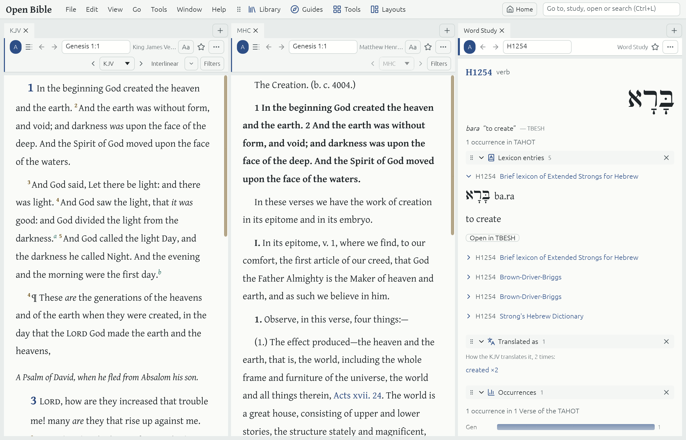
</picture>

## Features

<table>
<tr>
<td width="50%" valign="top">

### Read and compare

<picture>
  <source media="(prefers-color-scheme: dark)" srcset="docs/previews/gallery/front-page-text-comparison-dark-2x.png">
  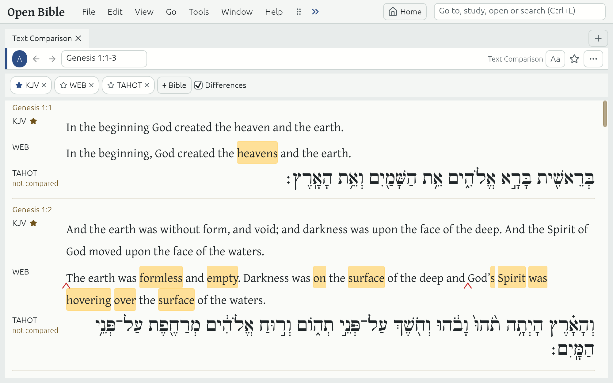
</picture>

Open Bibles and Commentaries in Panels side by side. [Link sets](docs/user-guide/link-sets.md)
keep them on the same verse; Text Comparison lines translations up verse by verse and marks
what differs. [Read and compare →](docs/user-guide/read-and-compare.md)

</td>
<td width="50%" valign="top">

### Hebrew and Greek, word by word

<picture>
  <source media="(prefers-color-scheme: dark)" srcset="docs/previews/gallery/front-page-interlinear-dark-2x.png">
  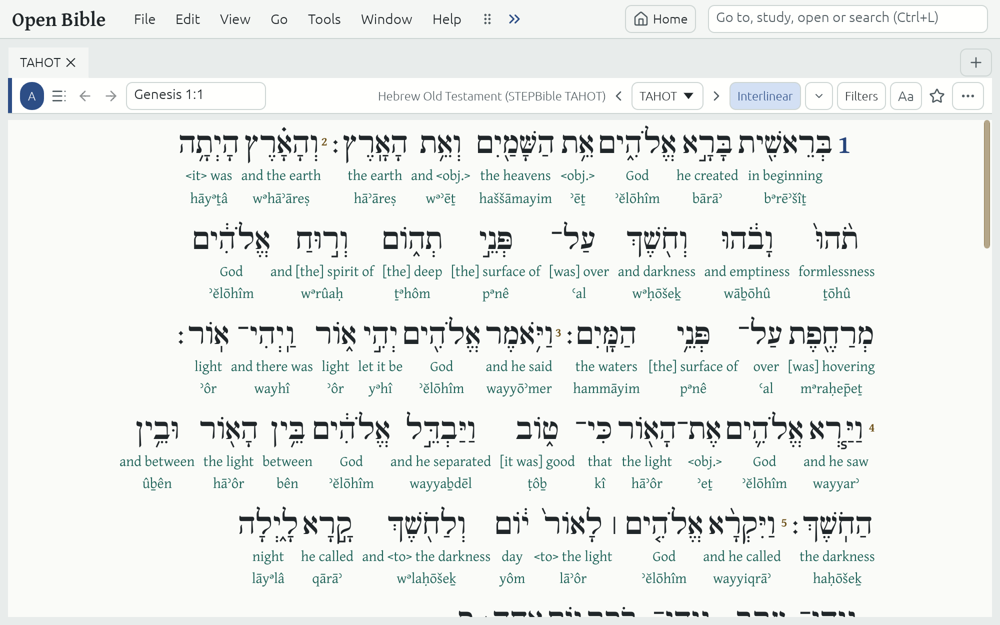
</picture>

The Hebrew Old Testament and Greek New Testament carry Strong's numbers and Morphology for
every word. Interlinear lines put each word's English gloss and transliteration under it (and,
under the KJV, the Hebrew or Greek behind each English word). [Read and compare →](docs/user-guide/read-and-compare.md)

</td>
</tr>
<tr>
<td width="50%" valign="top">

### Word Info and Word Study

<picture>
  <source media="(prefers-color-scheme: dark)" srcset="docs/previews/gallery/front-page-word-info-dark-2x.png">
  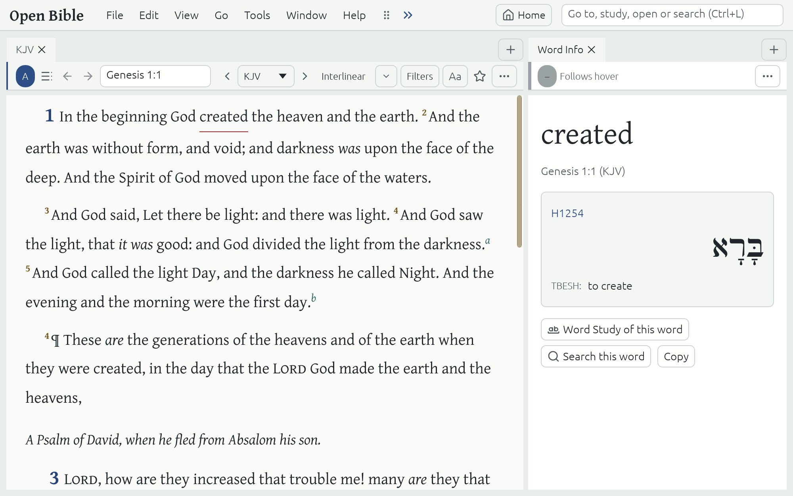
</picture>

Point at a word and Word Info shows the Hebrew or Greek behind it: its Lemma, Strong's number,
Morphology and Lexicon entry. Word Study follows one word through the whole Bible: what the
Lexicons say, how the Bibles translate it, where it occurs and the forms it takes.
[Word Study →](docs/user-guide/word-study.md)

</td>
<td width="50%" valign="top">

### Guides

<picture>
  <source media="(prefers-color-scheme: dark)" srcset="docs/previews/gallery/front-page-exegetical-guide-dark-2x.png">
  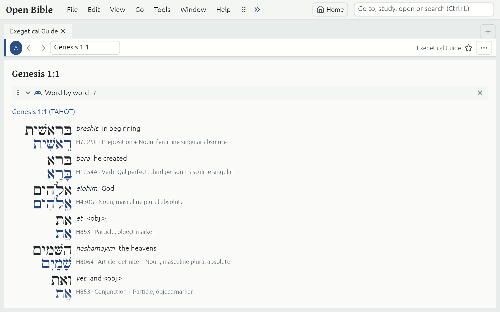
</picture>

A Guide gathers everything your library has on one thing, in sections: the Passage Guide on a
Passage, the Exegetical Guide on its Hebrew or Greek word by word, the Factbook on a person or
place, the Topic Guide on a topic. [Guides →](docs/user-guide/guides.md)

</td>
</tr>
<tr>
<td width="50%" valign="top">

### Search

<picture>
  <source media="(prefers-color-scheme: dark)" srcset="docs/previews/gallery/front-page-search-dark-2x.png">
  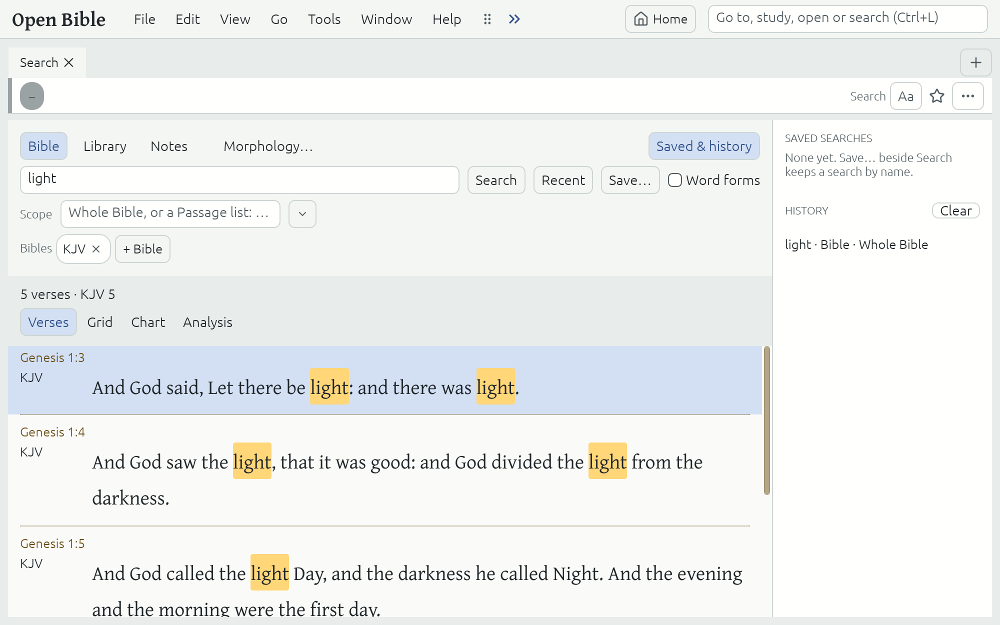
</picture>

Search your Bibles by word, phrase, Strong's number, Lemma or Morphology, the rest of your
library, or your Notes; see the results as Verses, a Grid, a Chart or an Analysis table.
[Search →](docs/user-guide/search.md)

</td>
<td width="50%" valign="top">

### Notes and Highlights

<picture>
  <source media="(prefers-color-scheme: dark)" srcset="docs/previews/gallery/front-page-notes-and-highlights-dark-2x.png">
  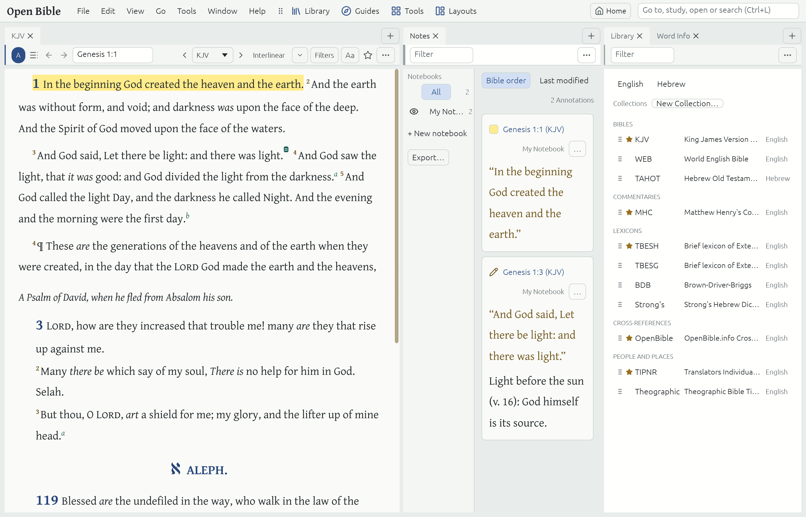
</picture>

Highlight in your own styles and write Notes that stay with the text in every Bible that has
the Passage. [Notes and Highlights →](docs/user-guide/notes-and-highlights.md)

</td>
</tr>
<tr>
<td width="50%" valign="top">

### Atlas

<picture>
  <source media="(prefers-color-scheme: dark)" srcset="docs/previews/gallery/front-page-atlas-dark-2x.png">
  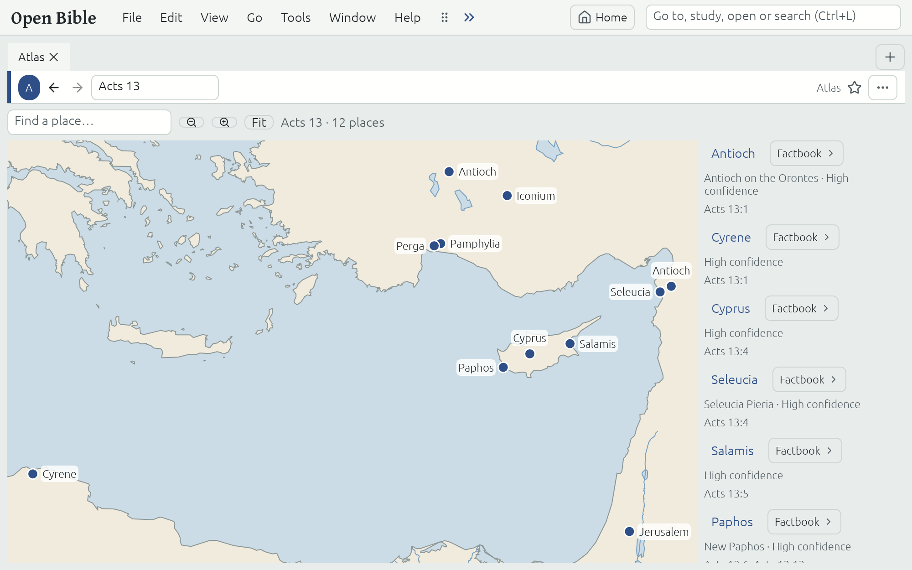
</picture>

The Atlas maps the places a Passage names on a map built into the app, with no network; click
a place for its Factbook. It follows the Bible you are reading. [Link sets →](docs/user-guide/link-sets.md)

</td>
<td width="50%" valign="top">

### Timeline

<picture>
  <source media="(prefers-color-scheme: dark)" srcset="docs/previews/gallery/front-page-timeline-dark-2x.png">
  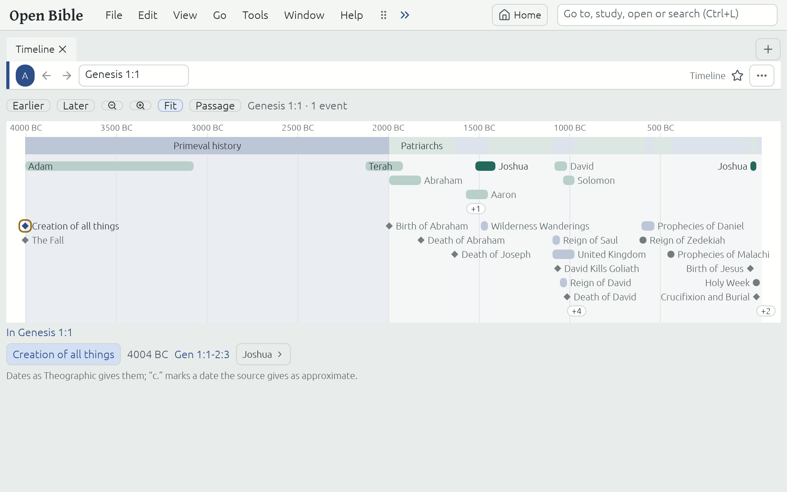
</picture>

The Timeline places a Passage's events and people in time, from Theographic's dated events,
and follows the Bible you are reading. [Link sets →](docs/user-guide/link-sets.md)

</td>
</tr>
<tr>
<td width="50%" valign="top">

### Home and Reading plans

<picture>
  <source media="(prefers-color-scheme: dark)" srcset="docs/previews/gallery/front-page-home-and-a-reading-plan-dark-2x.png">
  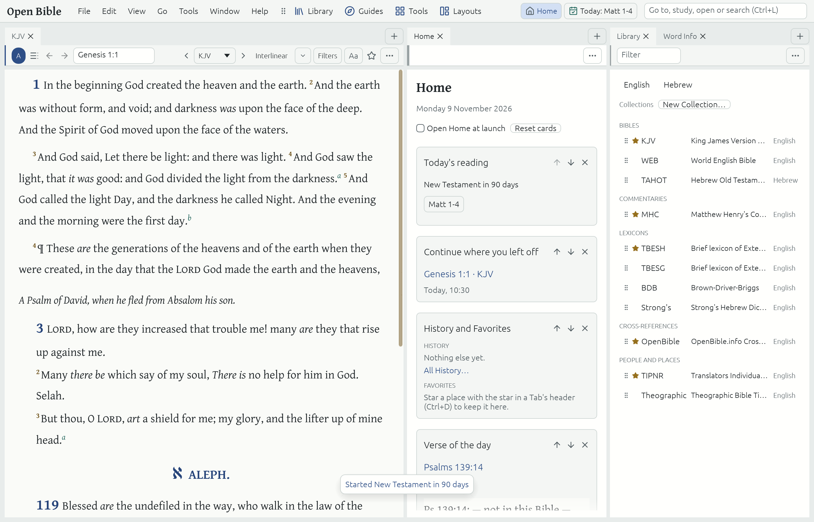
</picture>

Home shows Today's reading, where you left off and the Verse of the day. Reading plans schedule
Scripture day by day, with no account. [Getting started →](docs/user-guide/getting-started.md)

</td>
<td width="50%" valign="top">

### Layouts

<picture>
  <source media="(prefers-color-scheme: dark)" srcset="docs/previews/gallery/front-page-layouts-dark-2x.png">
  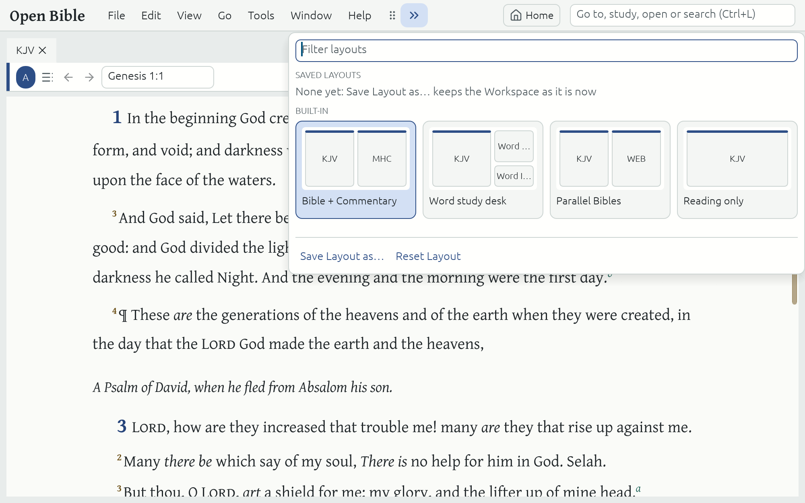
</picture>

Save an arrangement of Panels and Tabs and come back to it, or start from a Built-in Layout
such as "Bible + Commentary" or "Word study desk". [Layouts →](docs/user-guide/layouts.md)

</td>
</tr>
</table>

## Offline first

The app works with no network connection and needs no account. Your library, Notes,
Highlights and settings stay on your computer.

- **It never phones home.** No telemetry, no usage data. A crash writes a report to the Log
  folder and nowhere else; it leaves only if you send it from **Help → Report a problem…**,
  after reading every line of it
  ([ADR 0016](docs/adr/0016-crash-reports-stay-on-the-computer-until-the-user-sends-them.md)).
- **Its one network request of its own is the Update check**: a plain request for this
  repository's latest release, once per launch, carrying nothing about you or your data. Turn it
  off in **Settings → Updates**, and the app makes no request unless you ask
  ([ADR 0017](docs/adr/0017-the-app-may-ask-github-for-its-latest-release-and-replace-its-own-release-archive.md)).
- **Downloads happen only when you ask**: from **File → Get Resources…**, or the Starter library
  for a copy that came without it. Each Resource then works offline.

## Download

Each release has an archive per platform, with the Starter library inside it:

| Platform | File on the [latest release](https://github.com/inhesrom/openbiblesoftware/releases/latest) |
|---|---|
| Linux (x86_64) | `openbible-<version>-x86_64-unknown-linux-gnu.tar.gz` |
| macOS (Apple silicon) | `openbible-<version>-aarch64-apple-darwin.tar.gz` |
| Windows (x86_64) | `openbible-<version>-x86_64-pc-windows-msvc.zip` |

There is no Intel Mac or Linux ARM build yet, and no installer
([#272](https://github.com/inhesrom/openbiblesoftware/issues/272)).

## Getting started

1. Download the archive for your computer and unpack it anywhere you can write to.
2. Run `openbible` (`openbible.exe` on Windows) from the unpacked folder.
3. On the first launch the Starter library is copied into your library, and a short tour shows
   the window. **Help → User guide** (F1) is the [user guide](docs/user-guide/getting-started.md),
   offline.

The builds are not signed yet
([#272](https://github.com/inhesrom/openbiblesoftware/issues/272)), so each system asks once
before the first launch:

- **macOS**: double-clicking `openbible` shows *"openbible" Not Opened* (or *cannot be opened
  because Apple cannot check it for malicious software*). Click **Done**, open **System Settings →
  Privacy & Security**, click **Open Anyway** beside the message about `openbible`, and confirm.
  From Terminal instead: `xattr -dr com.apple.quarantine openbible-<version>-aarch64-apple-darwin`.
- **Windows**: *Windows protected your PC* (SmartScreen). Click **More info**, then **Run anyway**.
- **Linux**: the `.tar.gz` keeps `openbible` executable. If your archive tool dropped that, run
  `chmod +x openbible`.

An unpacked archive updates itself: **Help → Check for updates**, then **Update now** downloads
the new archive, checks it, backs up your User database and replaces the app in place.

## Resources and licences

Everything in the Starter library is in the public domain or openly licensed:

- **Bibles**: King James Version with Strong's Numbers, Berean Standard Bible, World English
  Bible, American Standard Version, and the Hebrew Old Testament and Greek New Testament of
  STEPBible (TAHOT and TAGNT), word by word with Strong's numbers and Morphology.
- **Commentaries**: Matthew Henry's Commentary; Jamieson, Fausset and Brown.
- **Lexicons**: STEPBible's brief Hebrew and Greek lexicons (TBESH, TBESG), Brown-Driver-Briggs,
  Strong's Hebrew and Greek dictionaries, Abbott-Smith.
- **Dictionaries**: Easton's, Smith's and Hitchcock's.
- **Cross-references and more**: OpenBible.info Cross References and Geocoding, the Berean
  Standard Bible's Parallel Passages, STEPBible's TIPNR names index, and the Theographic Bible
  Timeline.

**File → Get Resources…** adds more from online repositories of openly licensed Resources.
Each Resource's About page shows its licence and source, and **Help → Credits** lists every
source, font and library the app uses. Bundled fonts and data files are listed in
[`ATTRIBUTION.toml`](ATTRIBUTION.toml).

## Build from source

```sh
cargo run -p openbible   # desktop app
cargo xtask ci           # every gate CI runs
cargo xtask help         # list the gates; run one with cargo xtask <gate>
```

Needs the toolchain from `rust-toolchain.toml` (stable, with the `wasm32-unknown-unknown` target)
and, for tests, [`cargo-nextest`](https://nexte.st/) (`cargo xtask test` falls back to `cargo test`
locally). Bundled fonts and data files need an entry in [`ATTRIBUTION.toml`](ATTRIBUTION.toml).

A build from source has no Starter library until you build one:

```sh
cargo xtask starter                                   # downloads the sources, builds dist/starter/
cargo run -p openbible                                # a debug build finds dist/starter/ itself
cargo build --release -p openbible
OBS_STARTER_DIR=dist/starter target/release/openbible  # a release build needs to be told
```

See [`docs/dev/starter-library.md`](docs/dev/starter-library.md). Pushing a `v*` tag publishes
the Release archives; see [`docs/dev/releasing.md`](docs/dev/releasing.md).

## Contributing

Domain language lives in [`CONTEXT.md`](CONTEXT.md), decisions in [`docs/adr/`](docs/adr/),
developer notes in [`docs/dev/`](docs/dev/), and the v0.1 spec and implementation tickets in
[issue #1](https://github.com/inhesrom/openbiblesoftware/issues/1). Run `cargo xtask ci` before
opening a pull request. A change to what the app looks like updates the
[Screenshot gallery](docs/dev/screenshot-gallery.md) (`cargo xtask gallery --bless`), the
images on this page included.

| Layer | Crates |
|---|---|
| L0 | `obs-scripture` |
| L1 | `obs-model`, `obs-fonts` |
| L2 | `obs-formats`, `obs-layout`, `obs-search`, `obs-store` (the only SQLite user) |
| L3 | `obs-render` |
| L4 | `obs-engine` |
| L5 | `obs-reading` (the reading core without egui), `obs-mobile` (the Mobile app's screen models; no FFI) |
| L6 | `obs-ui-egui` (the only egui/eframe user) |
| apps | `openbible` (desktop), `obs-cli`, `obs-ffi` (the Mobile app's UniFFI crate, the one UniFFI crate Swift links), `uniffi-bindgen` |

A crate may depend only on its own or lower layers. Everything below L6 compiles for
`wasm32-unknown-unknown`. `obs-` is a working prefix until the product is named.

## Licence

Code is dual-licensed under MIT ([`LICENSE-MIT`](LICENSE-MIT)) or Apache-2.0 ([`LICENSE-APACHE`](LICENSE-APACHE)). Bundled content keeps its own licence; see
`ATTRIBUTION.toml` and each Resource's About view.
