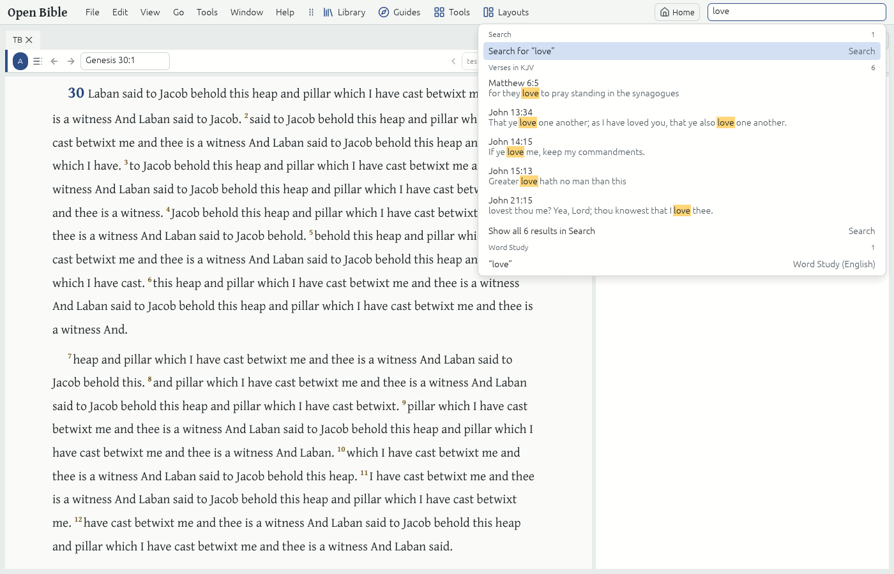
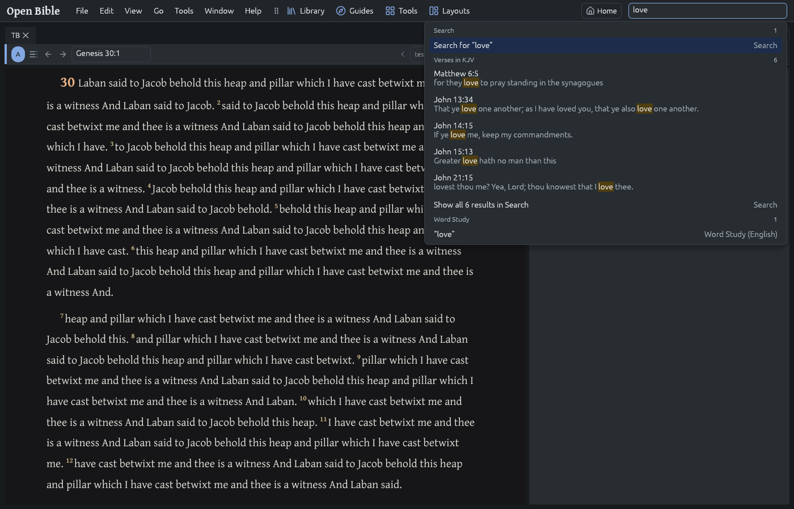
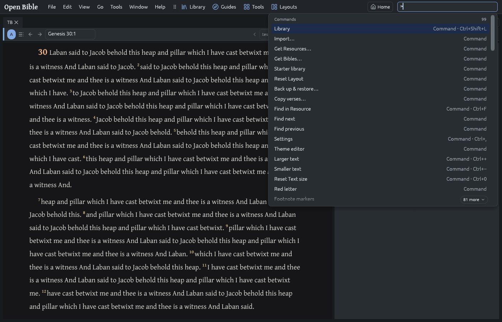

# The Command box (#139)

The box at the right of the menu bar. It replaced the toolbar's Search field, which only ran
`search.run`: typing now shows a dropdown of suggestions, best first, and Enter runs the
highlighted one. Searching is still there for any text: the list holds at most eight
suggestions, and when it is full Search keeps the last slot. Under the Search row the
**Search preview** (#295) shows the ★ Bible's first Verses for the text as it is typed.

| Light | Dark |
|---|---|
|  |  |
|  |  |

`UPDATE_PREVIEWS=1 cargo test -p obs-ui-egui command_box_results_previews` draws these
(`target/previews/command-box/`); `ffmpeg -i results-light.ppm results-light.png` converts
them.

## What text suggests

The engine decides (`crates/engine/src/command_box.rs`,
`Session::command_box_suggestions`); the UI (`crates/ui-egui/src/shell/command_box.rs`) only
draws the list and runs `command_box.run`. Ranks, highest first (equal ranks keep this order):

| Rank | Text | Suggestion | Runs |
|---|---|---|---|
| 100 | a Layout's name (any case) | Layout | `layout.restore` |
| 95 | `pg`, `guide`, `passage guide` + reference | Passage Guide | `guide.passage_guide {passage}` |
| 95 | `eg`, `exegetical guide` + reference | Exegetical Guide | `guide.exegetical_guide {passage}` |
| 95 | `compare`, `tc`, `text comparison` + reference | Text Comparison | `tool.text_comparison {passage}` |
| 95 | `xref`, `xrefs`, `cross-references` + reference | Cross-references | `tool.cross_references {passage}` |
| 95 | `ws`, `study`, `word study` + Strong's number, Lemma, transliteration or English words | Word Study | `word_study.open` / `word_study.choose` |
| 95 | `tg`, `topic`, `topic guide` + text (#148) | Topic Guide's chooser for it | `guide.topic_guide {text}` |
| 95 | `open` + Resource | Open … | as below |
| 95 | `search` + text | Search | `search.run` |
| 95 | `scroll speed` + 0.25 to 4 (`scroll speed 2`, `1.5x`, `0.5×`, `150%`, #293) | Scroll speed 2× · Setting · Motion | `view.scroll_speed {value}` |
| 92 | a Resource's abbreviation or title (any case) | Open Bible, Open Lexicon … | focuses its most recent Tab, else `resource.open` |
| 90 | a Bible reference: `jn 3:16`, `jn 3 16`, `1 jn 4 8`, `Rom 5:8; Jn 3:16` (first Passage) | Go to · *Bible* | see below |
| 90 | a Strong's number: `G26`, `h1254a` | Word Study | `word_study.open` |
| 85 | a command's label: `notes`, `history`, `close tab` (any command the box lists, #226) | Command (with its key: `Command · Ctrl+W`) | that command, on the focused Tab if it needs one |
| 80 | a Lemma in a Lexicon (`ἀγάπη`, `αγαπη`), or a transliteration in a Lexicon's transliteration index (`agape`, `chesed`) | Word Study (`ἀγάπη · G26`) | `word_study.open` |
| 65 | words starting a Resource's abbreviation or title (`extended strongs`) | Open … | as above |
| 60 | words starting a Layout's name | Layout | `layout.restore` |
| 56 | a Saved search's name or query (`Session::saved_searches_matching`, #179) | Saved search | `search.open_saved` |
| 55 | a Favorite's label or folder (`Session::favorites_matching`, #155) | Favorite | `favorite.open` |
| 50 | words starting a command's label | Command | that command |
| 10 | anything | Search for “…” | `search.run` |
| 5 | one to three words of letters that nothing above understood | Word Study (English) | `word_study.choose` |

References are read in the Standard versification, as everywhere outside a Bible's own Tab
(CONTEXT.md, Bible reference). A reference goes to the focused Tab if it is a Bible, else to
the most recent Bible Tab, else opens the first Bible in Preferred order there
(`Session::show_passage`, as the Notes Tool does). The Link set follows, as after any jump.

A Lemma's Strong's number is the Lexicon entry's own: `ResourceStore::keys_of_unit` lists the
Keys of the entry found by `lookup_key(Key::Lemma)`, and the non-alias Strong's number wins
(TBESH's `H1254A` rather than the base `H1254` it is also listed under). Lexicons are asked in
Preferred order, one suggestion per base number. On the Starter library this takes a few ms
per keystroke (release build: `agape` 14 ms, `chesed` 25 ms, references and numbers < 1 ms);
the UI asks only when the text changes. Without files (wasm) there are no Lemma suggestions.

## The results panel (#295)

The dropdown is a results panel under the box, its right edge under the box's:

- **Size.** min(640 pt, half the window) wide (`size::RESULTS`, `share::RESULTS_WIDTH`), never
  narrower than the box, and as tall as its rows up to 60% of the window
  (`share::RESULTS_HEIGHT`). It never leaves the window, at any Toolbar position or window
  size. It is measured in points, so it grows and shrinks with the Interface size. Its size
  is fixed: it cannot be resized.
- **Headings.** The suggestions sit under headings with their counts (Go to, Guides, Tools,
  Word Study, Resources, Layouts, Favorites, Saved searches, Commands, Search, Recent:
  `CommandBoxAction::group`). A heading comes where its best suggestion ranks
  (`suggestion_groups`), so the best suggestion of all is still first and Enter runs it.
- **Scrolling shows.** When the rows do not all fit, a solid scroll bar shows (hovered or
  not) and the bottom edge fades under a "N more" pill (with a chevron) counting the rows below it; with
  every row shown there is neither.
- **Long labels** are cut with "…" before their detail and shown whole in a tooltip on hover.
- **Two-line rows.** A Search preview Verse shows its reference, then its text with the
  match highlighted: the Search hit tint and ink of the Page palette as dark (and as High
  contrast) as the Theme (`hit_colors`), a pair that reads in the chrome beside any Page tone.
- **Screen readers** hear each row as `label · detail, 3 of 12`: its place among the rows
  that can be picked (headings and notes cannot).

## Search preview (#295)

`crates/engine/src/search_preview.rs`. While the dropdown offers Search, the UI hands the
text and its clock to `Session::update_search_preview` every frame. Once the text has not
changed for 100 ms (`PREVIEW_DEBOUNCE`) the engine searches it in the **★ Bible** (first
Bible in Preferred order), over its whole text, as a background job on the ready Search
index, the same search as the Search Tool's (`bible_search::desktop::run`, Word forms as
set), with snippets for the first rows only. The UI never waits: it asks to be drawn again
when the debounce ends (`search_preview_due_in`) and while the job runs. The last hits stay
until new ones arrive, so the list does not jump while the user types. A text whose search
was cancelled by more typing is searched again if the user types back to it.

The time to hits is gated in wall-clock time by the `search-preview` bench scenario
(`cargo xtask bench`, [bench.md](bench.md)): each query typed a key at a time over a
whole-Bible ★ Bible, from its last key to the frame drawing its hits, at most 150 ms (about
120 ms measured: the 100 ms debounce, then a frame or so for the worker's search).

Under the Search row it shows (`SearchPreview`):

| State | Rows |
|---|---|
| hits | heading "Verses in KJV" with how many Verses match, the first 5 (`PREVIEW_HITS`) as reference + snippet, then **Show all N results in Search** |
| no Verse matches | "No verses in KJV match" |
| no Bible in the library | **Add a Bible to search as you type**, which opens Get Bibles (`library.get_bibles`) |
| the ★ Bible's index being built | "Indexing KJV… results will appear here"; the search runs again when the index is ready |
| a query the Search Tool refuses, or no Search index here (wasm) | nothing |

The *Search "…"* row stays in every case. A click on a Verse, or Enter on it, goes there as
Go to does (`command_box.open_hit`: the Standard Verse in the focused Bible, else the most
recent Bible Tab, else the ★ Bible; an Unmapped verse opens in its own Bible); Alt opens a
new Tab. A new Tab for an Unmapped verse goes there once its Verse map is loaded
(`Effect::NavigateOpened`, as a Favorite opens), so the Link set it joins stays put. **Show all** runs the Search suggestion, as Enter on it does: the Search Tab with
the text, over its own scope and Bibles.

## All commands (#226)

`>` at the start of the text lists commands only: with nothing after it, every command the
box can run (`Session::listed_commands`: those needing no parameter but the focused Tab,
except `SCRIPTING_COMMANDS` and `IN_PLACE_COMMANDS`), menu commands first in menu order, the
disabled ones left out; with words after it, the commands whose label matches (whole label,
then words starting the label's words, then words anywhere in it). There is no limit of
eight: the dropdown scrolls, ↑/↓ keeping the highlight in view. Each shows its Keyboard
shortcut, as the platform writes it (`⌘W` on macOS, #262). **Help → All commands** (`app.commands`, Ctrl+Shift+P) puts the keyboard in the
box with `>` typed and the caret after it (`Effect::ListCommands`). A `>` text is not kept as
a recent entry. `docs/dev/menus.md` says where every command is.

A command run from the box behaves as from its menu, button or key:

- The box empties before the command runs, so one that puts the keyboard back in it (All
  commands, Command box) keeps what it put there; a failed run puts the text back.
- The command run is the one the dropdown showed: the UI passes its id (`command`), since the
  suggestions, found again, leave out disabled commands and one made possible meanwhile (an
  Undo) would shift them.
- Undo restore (`data.undo_restore`) is guarded as everywhere else (#217): the UI asks
  `Session::command_box_choice` which command the chosen suggestion runs and, for a restore
  or its undo, saves the Notes being written first (holding the undo back if the database
  refuses them) and forgets the Notes Tab's drafts after.
- Word Info's Copy (`word_info.copy`) hands its text to the UI as `Effect::CopyText`, which
  writes the clipboard, so the box, a key and the Copy button all copy.

## Keyboard and mouse

- **Ctrl+L** (`command_box.focus`, Cmd+L on macOS) puts the keyboard in the box and selects its
  text, from anywhere, also from another text field.
- **↑ / ↓** move the highlight, **PgUp / PgDn** by the rows that fit, **Home / End** to the
  first and last row (they move the highlight, not the caret, while the dropdown shows),
  each keeping it in view; **Enter** runs it; **Alt+Enter** runs it in a new Tab
  (`new_tab: true`: a new Tab of the Bible, Guide or Tool rather than moving the open one; a new
  Tab joins the opener's Link set, which then follows it); **Esc** leaves the box.
- A click on a row runs it (Alt held: in a new Tab).
- After running, the box empties and the keyboard goes back to the Workspace. A suggestion
  that fails (no Bible in the library, say) leaves the text and shows why.

## Recent entries

Every text run from the box is remembered, newest first, at most 20, in the User database
(preference `command-box.recent`, a JSON array, like the Search Tool's recent queries). The
empty box lists up to 8 as **Recent**; running one runs that text's best suggestion again and
moves it to the top.

## Commands

- `command_box.focus` — Ctrl+L; the UI focuses the box (`Effect::FocusCommandBox`).
- `command_box.suggest {text?}` — the suggestions as JSON (`kind`, `label`, `detail`); an
  empty text gives the recent entries. `obs-cli run command_box.suggest text=agape`.
- `command_box.run {text, choice?, new_tab?}` — run suggestion `choice` (default 0, the best)
  for `text` and remember the text.
- `command_box.open_hit {hit, new_tab?}` — open Verse `hit` (from 0) of the Search preview
  shown.

Tests: `crates/engine/src/command_box_tests.rs` (the parser and ranking, each action, recent
entries across a restart, the headings, on a real `.obr` library with the Starter Lexicons'
excerpts), `crates/engine/src/search_preview_tests.rs` (the debounced query, the ★ Bible's
first five Verses and the count, no Bible, an index being built, opening a hit, a cancelled
text typed again, an Unmapped hit opened from a linked Bible) and
`crates/ui-egui/src/command_box_tests.rs` (Ctrl+L, typing, ↑/↓, PgUp/PgDn, Home/End, Enter,
Alt+Enter, Esc, click, recent entries after a relaunch; the panel's size at every Toolbar
position, window size and Interface size; the scroll bar and "N more"; cut labels and their
tooltips; "N of M" for screen readers; the Search preview's debounce and frame scheduling
(on the harness's 60 Hz clock), its keys and clicks, Show all, Get Bibles and Indexing; its
highlights' contrast in every Theme and Page tone).
