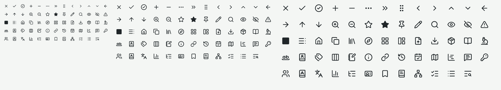
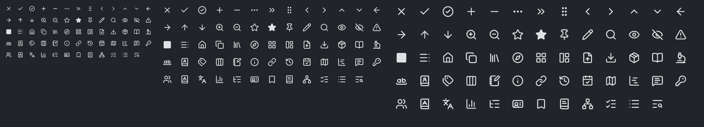
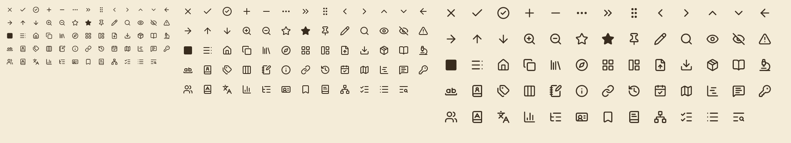

# Icon catalogue (#220)

The interface's icons (`crates/ui-egui/src/icons.rs`, ADR 0012), generated by `UPDATE_PREVIEWS=1 cargo test -p obs-ui-egui icon_catalogue_previews`. Each image shows every icon in the order of the table, 13 to a row, at 16 points on a 1×, a 1.5× and a 2× display (left to right), as rasterized for that scale, in the theme's ink: Light and Dark chrome, and the Sepia page.

| # | Icon | SVG (Lucide 1.70.0) |
|---|---|---|
| 1 | Close | `x.svg` |
| 2 | Check | `check.svg` |
| 3 | CheckCircle | `circle-check.svg` |
| 4 | Add | `plus.svg` |
| 5 | Remove | `minus.svg` |
| 6 | More | `ellipsis.svg` |
| 7 | Overflow | `chevrons-right.svg` |
| 8 | Grip | `grip-vertical.svg` |
| 9 | ChevronLeft | `chevron-left.svg` |
| 10 | ChevronRight | `chevron-right.svg` |
| 11 | ChevronUp | `chevron-up.svg` |
| 12 | ChevronDown | `chevron-down.svg` |
| 13 | Back | `arrow-left.svg` |
| 14 | Forward | `arrow-right.svg` |
| 15 | MoveUp | `arrow-up.svg` |
| 16 | MoveDown | `arrow-down.svg` |
| 17 | ZoomIn | `zoom-in.svg` |
| 18 | ZoomOut | `zoom-out.svg` |
| 19 | Star | `star.svg` |
| 20 | StarFilled | `star-filled.svg` |
| 21 | Pin | `pin.svg` |
| 22 | Note | `pencil.svg` |
| 23 | Search | `search.svg` |
| 24 | Shown | `eye.svg` |
| 25 | Hidden | `eye-off.svg` |
| 26 | Warning | `triangle-alert.svg` |
| 27 | Swatch | `square-filled.svg` |
| 28 | Contents | `table-of-contents.svg` |
| 29 | Home | `house.svg` |
| 30 | Copy | `copy.svg` |
| 31 | Library | `library.svg` |
| 32 | Guides | `compass.svg` |
| 33 | Tools | `layout-grid.svg` |
| 34 | Layouts | `layout-panel-left.svg` |
| 35 | Import | `file-up.svg` |
| 36 | Download | `download.svg` |
| 37 | Starter | `package.svg` |
| 38 | PassageGuide | `book-open.svg` |
| 39 | ExegeticalGuide | `microscope.svg` |
| 40 | WordStudy | `whole-word.svg` |
| 41 | Factbook | `book-user.svg` |
| 42 | TopicGuide | `tags.svg` |
| 43 | TextComparison | `columns-3.svg` |
| 44 | Notes | `notebook-pen.svg` |
| 45 | WordInfo | `info.svg` |
| 46 | CrossReferences | `link.svg` |
| 47 | History | `history.svg` |
| 48 | ReadingPlans | `calendar-check.svg` |
| 49 | Atlas | `map.svg` |
| 50 | Timeline | `chart-gantt.svg` |
| 51 | Commentaries | `message-square-text.svg` |
| 52 | KeyWords | `key-round.svg` |
| 53 | People | `users.svg` |
| 54 | Lexicon | `book-a.svg` |
| 55 | TranslatedAs | `languages.svg` |
| 56 | Occurrences | `chart-column.svg` |
| 57 | Forms | `list-tree.svg` |
| 58 | Summary | `id-card.svg` |
| 59 | KeyPassages | `bookmark.svg` |
| 60 | Articles | `book-text.svg` |
| 61 | Related | `network.svg` |
| 62 | GrammaticalNotes | `list-checks.svg` |
| 63 | TopicalEntries | `list.svg` |
| 64 | LibrarySearch | `text-search.svg` |
