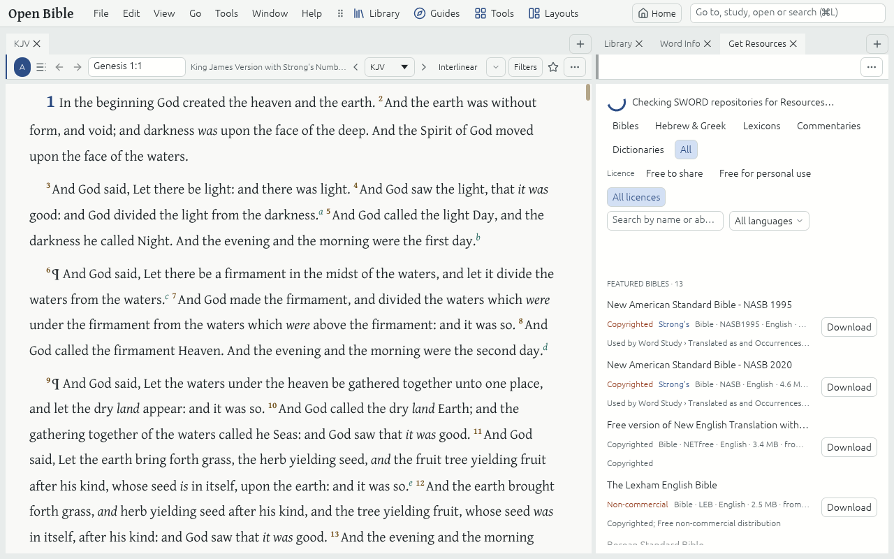

# Get Resources

Your library starts with the Starter library. **File → Get Resources…** adds more, from online repositories of openly licensed Resources; each one is downloaded once and then works offline.

## Download

1. Open **File → Get Resources…** (or **Get Bibles…** for Bibles only).
2. Filter by Resource type, by language (type a language's name) or by licence: **Free to share**, **Free for personal use** or **All licences**.
3. Click **Download** beside a Resource. It is imported into your library and opens from the Library.

Featured Resources come first; **Hebrew & Greek** lists the original-language Bibles, and says which carry Strong's numbers and Morphology for [Word Study](word-study.md).

## Books from the Christian Open Library

The **Books** filter is the [Christian Open Library](https://christianopenlibrary.org): some 7,600 sermons, treatises, confessions, commentaries and church records, from the Church Fathers to the early 1900s. Its books are shared with members by invitation on GitHub, so you need your own access:

1. Choose **Ask for access…**, and accept the invitation GitHub emails you.
2. Choose **Make a GitHub token…** and make a fine-grained token that can read `Christian-open-library/books`, then paste it and choose **Connect**. The token is kept in this computer's keychain and sent only to GitHub. Or choose **Use a local copy…** if you keep the books with git or GitHub Desktop.
3. Search and filter the list (type, tradition, collection, author, years), tick the works you want, and choose **Download**. Each work comes into your Library as a Book. **Download everything…** brings the whole library; it is several gigabytes once imported.

**Check for new books** reads the library again: books that changed show **Changed in COL**, and **Update** replaces them, keeping your Notes and Highlights on their text. A book COL no longer has stays in your Library. Nothing is asked of GitHub until you click. **Browse the catalogue** lists every work before you have access.

Without downloading anything, right-click a verse or selected text and choose **Search Christian Open Library** to search the library's website in your browser; the Passage Guide's Cited in section offers the same for its Passage. Settings → Search turns it off.

## Updates

When a repository offers a newer edition of a Resource you downloaded, Get Resources marks it **Update available**, and **Update all** brings every one up to date. Nothing downloads until you click.

## Import a file

**File → Import…** adds a Bible you already have as a USFM or SWORD file. An Import report then says what was brought in.

**Markdown book…** in the same window adds a book kept as Markdown, such as a sermon, treatise or confession from the Christian Open Library. Choose its `.md` file; a long work split into Part files comes in as one Book. **Markdown folder…** adds every book in a folder and its subfolders, each its own Book, with one Import report listing what came in and what could not. Type a page ("p. 23") in a Book's header to go to that printed page. A Book is read by its chapters, shows its printed pages as [p. 23], and its Bible references are links. Its licence is the one its file names; one the app does not recognise is shown as given, and the Book is marked for personal use.

## The Starter library

**File → Starter library** lists every Starter Resource, and adds back any you removed. **Help → Credits** credits every Starter Resource and its licence; each Resource's own licence and Attribution are in its About Tab (right-click it in the Library Tab and choose About).
