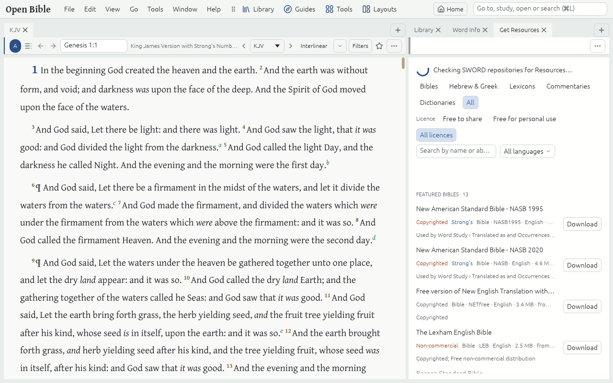

# Get Resources

Your library starts with the Starter library. **File → Get Resources…** adds more, from online repositories of openly licensed Resources; each one is downloaded once and then works offline.

## Download

1. Open **File → Get Resources…** (or **Get Bibles…** for Bibles only).
2. Filter by Resource type, by language (type a language's name) or by licence: **Free to share**, **Free for personal use** or **All licences**.
3. Click **Download** beside a Resource. It is imported into your library and opens from the Library.

Featured Resources come first; **Hebrew & Greek** lists the original-language Bibles, and says which carry Strong's numbers and Morphology for [Word Study](word-study.md).

## Updates

When a repository offers a newer edition of a Resource you downloaded, Get Resources marks it **Update available**, and **Update all** brings every one up to date. Nothing downloads until you click.

## Import a file

**File → Import…** adds a Bible you already have as a USFM or SWORD file. An Import report then says what was brought in.

## The Starter library

**File → Starter library** lists every Starter Resource, and adds back any you removed. **Help → Credits** credits every Starter Resource and its licence; each Resource's own licence and Attribution are in its About Tab (right-click it in the Library Tab and choose About).
