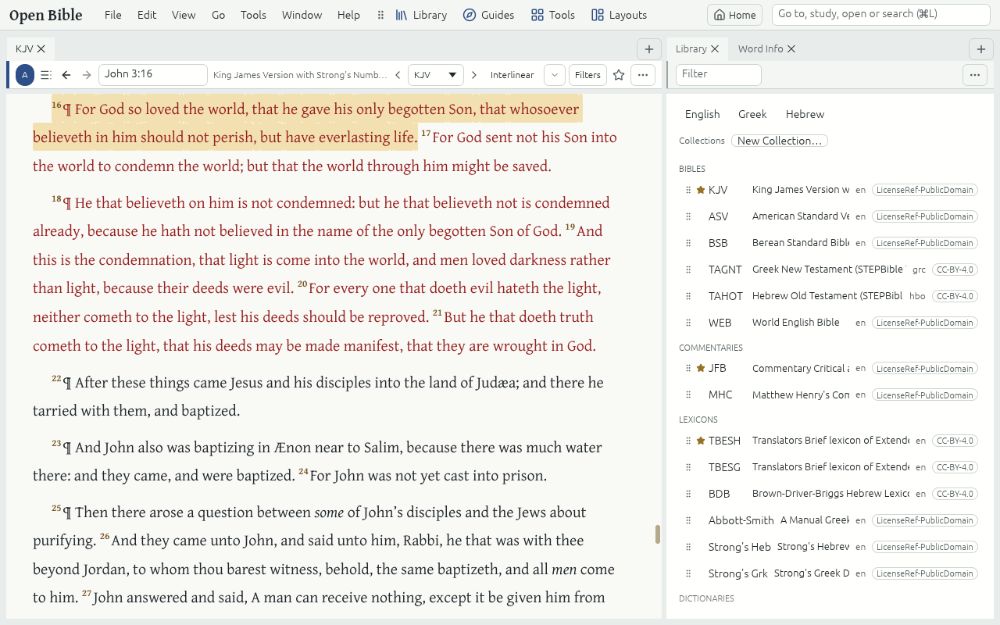

# Getting started

Open Bible is a Bible study app that works offline. You read, compare, annotate and search a library of open Resources on your own computer; nothing you write leaves it.

## The window

- **The menu bar** holds the menus File, Edit, View, Go, Tools, Window and Help.
- **The toolbar** holds the Launchers: **Library**, **Guides**, **Tools** and **Layouts**. Each drops down what it opens.
- **The Command box** at the right reads what you type: a Bible reference such as Jn 3:16 goes there, a word searches, "pg Rom 8" opens a Passage Guide and a command's name runs it. Press Ctrl+L to type in it.
- **Panels and Tabs** fill the rest. A Panel holds one or more Tabs; each Tab shows a Resource, a Guide or a Tool. Drag a Tab's title to another Panel or a Panel's edge to move it.

## Your first steps

1. The **Starter library** is added on the first launch: Bibles, Commentaries, Lexicons, Dictionaries, Cross-references and People & places indexes, all openly licensed. **File → Starter library** lists them.
2. **Home** (the Home button, or Alt+H) shows Today's reading, where you left off, the Verse of the day and Quick start.
3. Type a Bible reference in the Command box, or open a Bible from the Library.
4. Read on in this guide: [Read and compare](read-and-compare.md), [Link sets](link-sets.md), [Guides](guides.md), [Word Study](word-study.md), [Search](search.md), [Notes and Highlights](notes-and-highlights.md), [Get Resources](get-resources.md), [Layouts](layouts.md) and [Keyboard](keyboard.md).

## Help

- **Help → User guide** (F1) opens this guide. The box in its header searches every page.
- **Help → Take the tour** shows the tour of the window again.
- **Help → All commands** (Ctrl+Shift+P) lists every command with its Keyboard shortcut.
- **Help → Report a problem…** shows what would be sent before anything is.
