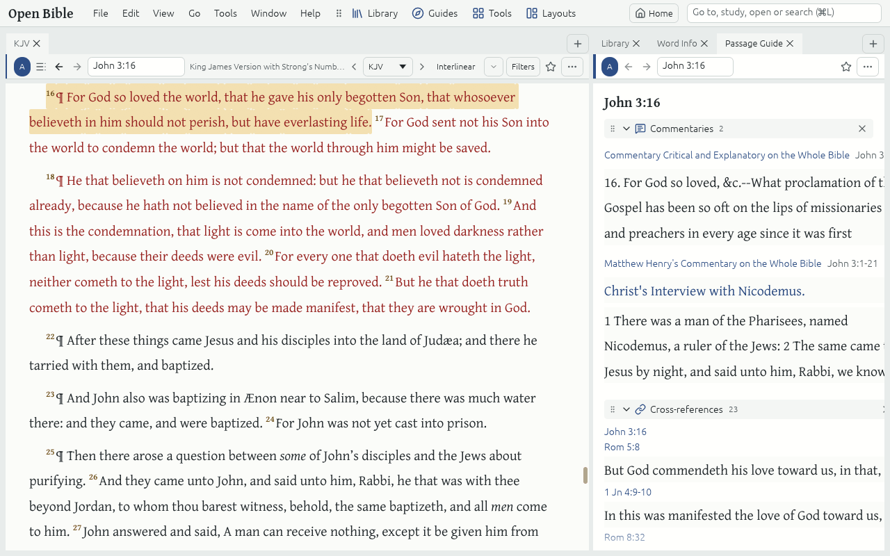

# Guides

A **Guide** is a Tab that gathers everything your library has on one Passage, word, person, place or topic, in sections. Open them from **Guides** on the toolbar (Alt+G), the **Tools** menu, the Command box or a right-click on the text.

## The Guides

- **Passage Guide**: Commentaries, Cross-references, Parallel passages, Key words and People & places for a Passage. Type "pg Rom 8" in the Command box to open one.
- **Exegetical Guide**: a Passage word by word in its Hebrew or Greek, with each word's Lemma, Gloss and Morphology in plain English ("eg Jn 3:16").
- **[Word Study](word-study.md)**: one Hebrew or Greek word across the whole Bible.
- **Factbook**: one person or place: other names, a map, Key Passages, Dictionary articles and related people and places.
- **Topic Guide**: a topic such as forgiveness across the Topical indexes and Dictionaries ("tg forgiveness").

## Sections

- Click a section's title to fold it, drag it to move it, and × hides it. The order is kept for each kind of Guide; **Reset arrangement** puts it back.
- A section with nothing in your library says so, and offers what would fill it: [Get Resources](get-resources.md) at the right filter, or the Starter library.
- Click a reference to go there in the Guide's Link set; Ctrl+click opens a new Tab.

## The Tools

The **Tools** Launcher and menu open the Tools: **Search**, **Text Comparison**, **Notes**, **Word Info**, **Cross-references**, **Favorites**, **History**, **Reading plans**, the **Atlas** (a map of the places a Passage names) and the **Timeline** (the Eras, Lifespans and Events of biblical history).
