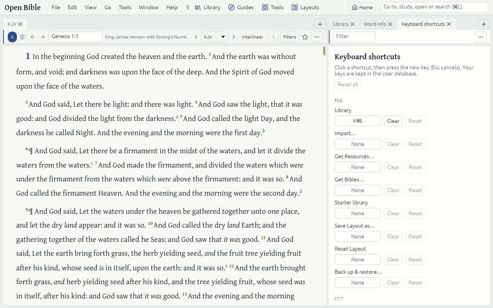

# Keyboard

Everything in the app can be reached from the keyboard. On macOS, Ctrl in this guide means ⌘ (Cmd): Ctrl+L is ⌘L.

## Keys to know

- **Ctrl+L**: type in the Command box. **Ctrl+Shift+P**: All commands.
- **F1**: this User guide. **Ctrl+Comma**: Settings.
- **Alt+L**, **Alt+G**, **Alt+T**, **Alt+Y**: the Library, Guides, Tools and Layouts Launchers. **Alt+H**: Home.
- **Ctrl+F**: Find in Resource. **Ctrl+Shift+F**: Search.
- **Alt+←**, **Alt+→**: Back and Forward. **Ctrl+PageUp**, **Ctrl+PageDown**: the previous and next chapter.
- **Ctrl+Shift+N**: a Note on the selection. **Alt+1…9**: Highlight it.
- **Ctrl+Z**, **Ctrl+Shift+Z**: Undo and Redo.
- **Ctrl+Plus**, **Ctrl+Minus**, **Ctrl+0**: Larger, smaller and default Text size.

## Move around the window

- **F6** and **Shift+F6** move the keyboard between the menu bar, the toolbar and each Panel.
- **Ctrl+1…9** go to the first nine Panels.
- **Ctrl+Tab** switches between a Panel's Tabs, most recently used first; **Ctrl+W** closes a Tab.
- **Tab** moves between the controls of a Tab; Enter or Space presses a button; Esc closes a menu or pop-up.

## Change a key

**Help → Keyboard shortcuts** lists every Keyboard shortcut, grouped by menu, with a search box. Click a key to record a new one, or Clear or Reset it; Reset all puts every default back. A key another command has is not saved until you swap the two or cancel.
