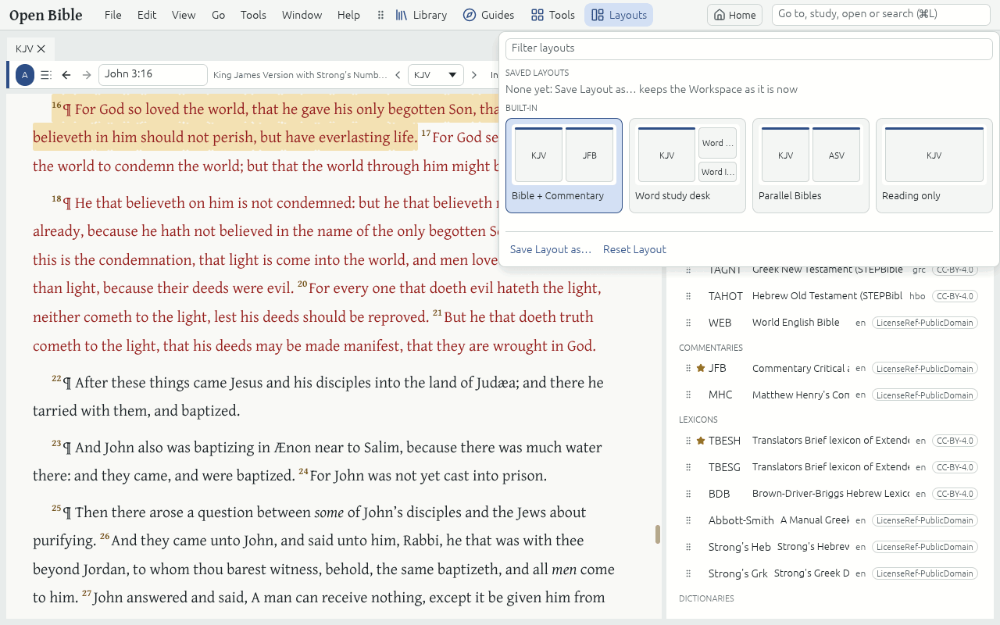

# Layouts

A **Layout** is a saved arrangement of your Panels and Tabs: which Resources, Guides and Tools are open, where, in which Link sets and at which place.

## Use a Layout

- Click **Layouts** on the toolbar (Alt+Y) and click a card. Each card shows a thumbnail of its Panels.
- The Built-in Layouts are "Bible + Commentary", "Word study desk", "Parallel Bibles" and "Reading only". They use the first Resources in your Preferred order, at the Passage you are reading.

## Save your own

1. Arrange the Panels and Tabs: drag a Tab's title onto another Panel, or to a Panel's edge to make a new Panel beside it.
2. Choose **File → Save Layout as…** and give it a name.

A saved Layout's card has Rename and Delete. **File → Reset Layout** puts back the default arrangement.

## The Last session and closed Tabs

- The app saves your Workspace as you go and brings it back at the next launch, even after a crash.
- **Window → Reopen closed Tab** (Ctrl+Shift+T) brings back what you closed; **Window → Recently closed** lists the last 20.
- **Window → Float in new window** moves a Tab into a window of its own, for a second monitor.
