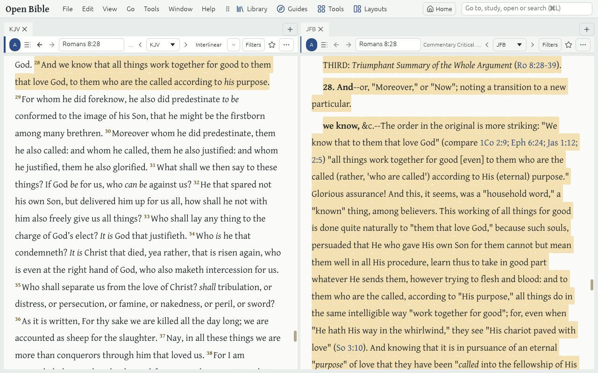

# Link sets

A **Link set** is a lettered group of Tabs (A, B, C, D) that share one place. Move one Tab to a Passage and every other Tab in its Link set goes there too: a second Bible, a Commentary, the Passage Guide, Text Comparison, Cross-references, the Atlas and the Timeline.

## Join or leave a Link set

- The coloured letter at the left of a Tab's header is its Link set. Click it and choose another letter, or **Not linked**.
- A Tab you open from a linked Tab joins its Link set, so a Guide opened while reading starts where you are.
- A Tab that is not linked shows –, and stays where it is.

## How Tabs follow

- Bibles follow by Verse, even when they number Verses differently: Psalm 3:1 in an English Bible is Psalm 3:2 in a Hebrew one, and each shows its own.
- A Commentary goes to the section on that Passage.
- A Lexicon follows a Word Study's Strong's number, and a Dictionary follows a Topic Guide's topic.

## Tips

- Use two Link sets to keep two places open: A for the Passage you study, B for a cross-reference you follow.
- [Layouts](layouts.md) keep each Tab's Link set.
