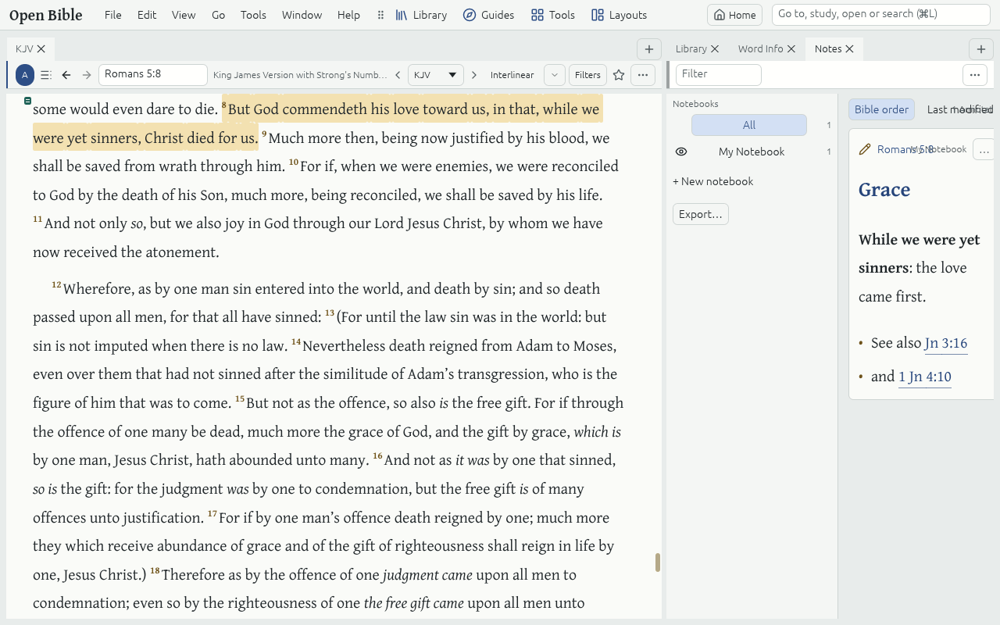

# Notes and Highlights

Your **Notes** and **Highlights** are Annotations: they stay with the text, in every Bible that has the Passage, and are kept on your computer in the User database.

## Highlight

1. Select words in a Resource Tab (drag, or double-click a word).
2. Click a colour on the toolbar that appears over the selection, or press Alt+1…9.

**View → Highlight styles** makes your own styles, such as "Promises", in Highlight palettes.

## Write a Note

1. Select words, then click ✏ **Note** on the selection toolbar (or press Ctrl+Shift+N).
2. Type, and click away or press Esc: it saves as you go.

A Note can carry headings, lists, **bold**, *italic* and links. Bible references you type, such as Rom 5:8, become links that show the Verse.

## The Notes Tool

**Tools → Notes** lists every Annotation in your Notebooks, in Bible order or by last change. Click a Note's text to edit it in place; click its reference to go there. The 👁 beside a Notebook shows or hides its Annotations in the text. **Export…** under the Notebooks saves the Notes shown as Markdown or HTML, or prints them.

## Undo and keep safe

- **Edit → Undo** (Ctrl+Z) takes back any change to your Notes and Highlights.
- **File → Back up & restore…** saves everything you made into one Backup file, and restores it.
