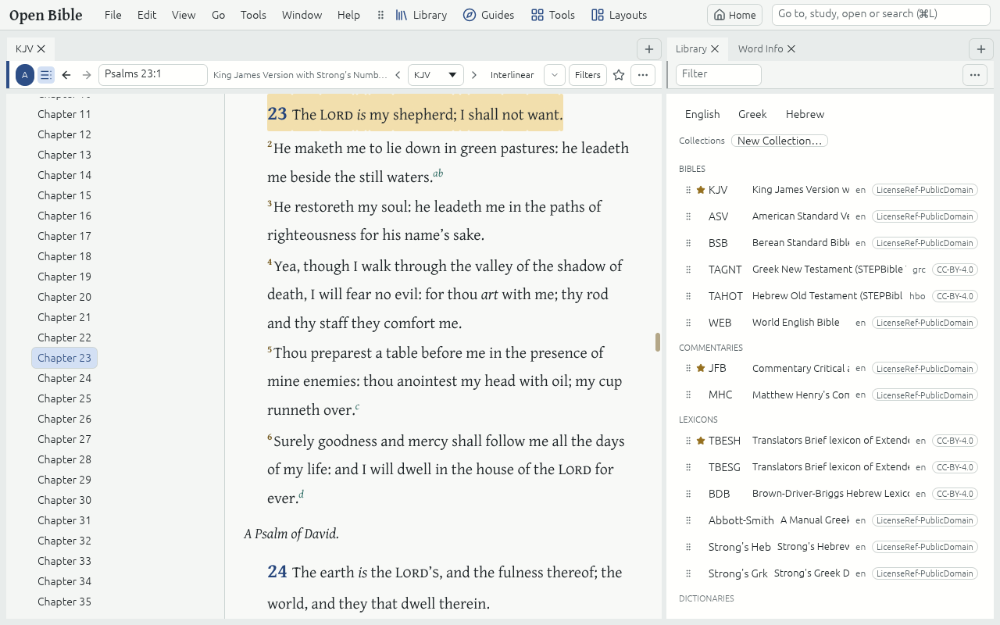

# Read and compare

## Open a Bible

- Click **Library** on the toolbar (or press Alt+L) and click a Bible, or open the Library Tab (Ctrl+Shift+L) and double-click a row.
- Type a Bible reference in the Command box (Ctrl+L), such as Rom 8:28 or "ps 23", and press Enter: the focused Bible goes there.
- The box in a Bible Tab's header takes a reference too. Ctrl+PageUp and Ctrl+PageDown go to the previous and next chapter; the arrows in the header are Back and Forward (Alt+← and Alt+→).

The ★ marks the first Resource of each Resource type in your Preferred order: the ★ Bible is the one lookups and Guides use first. Drag a row in the Library Tab to change the order.

## Find your way in a Resource

- **Contents** (the button in the Tab's header) shows a Bible's books and chapters, or a Commentary's sections, beside the text. Click a line to go there.
- **Parallel resources**: the dropdown in the header and the arrows beside it switch the Tab to another Bible (or Commentary) at the same place (Ctrl+[ and Ctrl+]).
- **Find in Resource** (Ctrl+F) marks every match of a word in this Resource; Enter moves to the next.
- **Footnotes** are the small raised letters in the text. Rest the pointer on one to read it; click it to keep it open.

## Change how text looks

- **View → Larger text** and **View → Smaller text** (Ctrl+Plus, Ctrl+Minus) change the Text size; Ctrl+0 resets it.
- **One Resource larger or smaller**: click **Aa** in a Tab's header (or open the Tab menu at the right of the header) and drag the Text size slider, or click A− and A+. The text changes as you drag, in every Tab of that Resource, and the Resource keeps its own size: Larger and Smaller text no longer move it. **Reset** beside the slider makes it follow the Text size again. Ctrl+Alt+Plus, Ctrl+Alt+Minus and Ctrl+Alt+0 do the same for the focused Tab's Resource. In Text Comparison and Search each Bible's rows are drawn at its own size, and Aa changes the Bible you last clicked into. **Settings → Text and fonts** lists every Resource with its own size.
- **View → Reading layout** sets paragraphs or one verse per line, large chapter numbers, section headings, the column width and justified text for the focused Tab.
- **View → Theme** and **View → Page tone** change the colours; **View → Settings** (Ctrl+Comma) has every preference in one place.
- **Scroll speed** in Settings (under Motion) makes the mouse wheel, the trackpad and the arrow keys scroll further or less far, from 0.25× to 4×, everywhere in the app; Reset puts 1× back. Page Up and Page Down still move one page.
- **Interlinear** in the header of a Bible with Strong's numbers shows Interlinear lines: the Hebrew or Greek behind each word.

## Compare Bibles

**Tools → Text Comparison** shows one Passage in several Bibles, Verse by Verse. Add Bibles with **+ Bible**, and turn on **Show differences** to mark the wording that differs from the base Bible. It follows its Link set, so it moves with the Bible you read.

For two Bibles side by side, open the second in another Panel and put both Tabs in the same [Link set](link-sets.md), or choose the Built-in Layout "Parallel Bibles" from **Layouts**.
