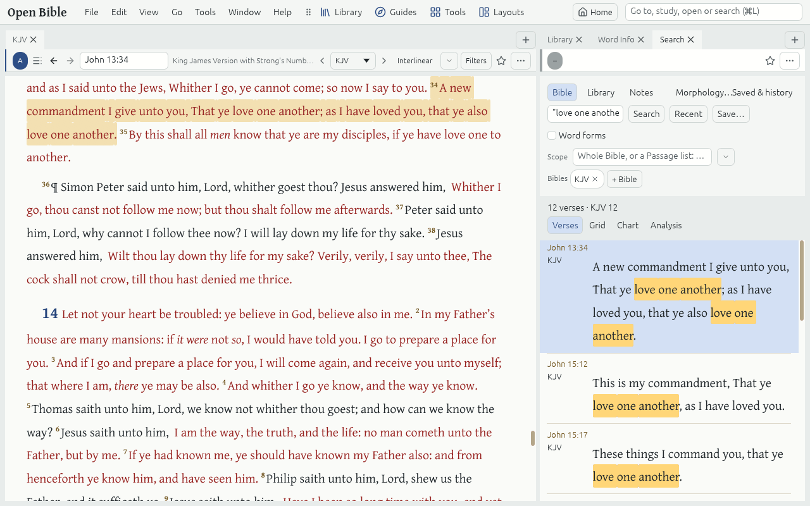

# Search

**Tools → Search** (Ctrl+Shift+F) searches your Bibles, the rest of your library or your Notes. Type in the Command box and choose the search there, or type in the Search Tab's own box and press Enter.

## Three modes

- **Bible** finds Verses in the chosen Bibles. Its results show as Verses, a Grid, a Chart or an Analysis table.
- **Library** finds paragraphs in Commentaries, Lexicons and Dictionaries.
- **Notes** finds your Notes.

The **Search scope** beside the box limits a search to some Passages (the New Testament, "Rom 1-8") and some Resources or Collections.

## Writing a query

- `faith hope` finds both words; `faith OR hope` either; `faith -works` faith without works.
- `"love one another"` finds the phrase; `lov*` finds love, loved, loving.
- `strong:G26` finds a Strong's number, `lemma:agapao` a Lemma.
- `@aorist imperative` finds grammar in plain English; **Morphology…** under the box writes it for you.
- `faith NEAR/5 works` finds words close together; `grace WITHIN 2 verses peace` across neighbouring Verses.
- **Word forms** (the toggle beside the box) lets "love" also find "loveth" and "loved".

## Keep a search

**Save…** keeps a search under a name in the sidebar, as a Saved search. Its History lists what you ran lately.

To find a word in the Resource you are reading, use **Edit → Find in Resource** (Ctrl+F) instead.
