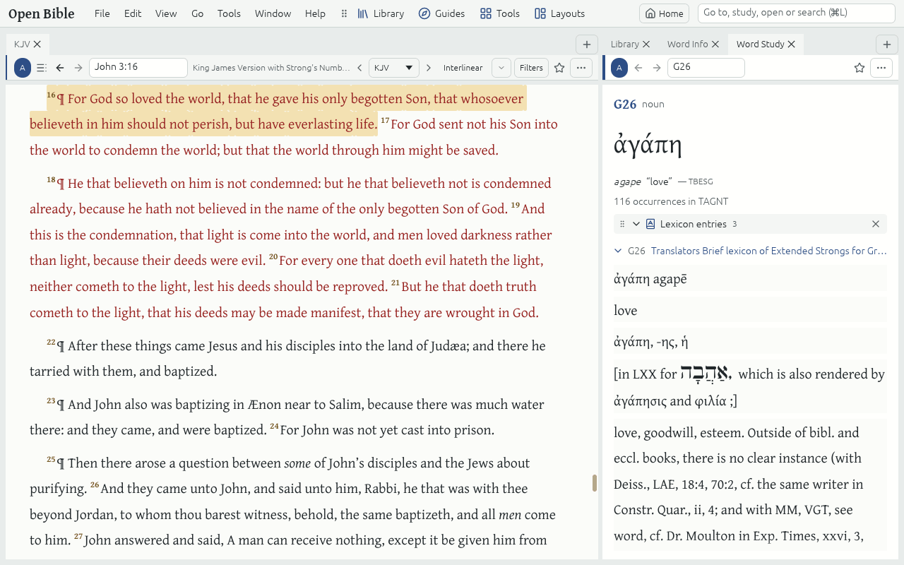

# Word Study

**Word Study** follows one Hebrew or Greek word, by its Strong's number, through the whole Bible: what the Lexicons say, how the Bibles translate it, where it occurs and the forms it takes.

## Open a Word Study

- **Right-click a word** in a Bible with Strong's numbers (such as the KJV with Strong's or the Berean Standard Bible) and choose **Word Study**.
- Type a Strong's number, a Lemma or its spelling in English letters in the Command box: "G26", "ἀγάπη" or "ws agape".
- **Guides → Word Study** asks for a word. An English word lists the Strong's numbers behind it to choose from.

## Its sections

- **Lexicon entries**: each Lexicon's entry, in your Preferred order.
- **Translated as**: the English words the Bibles use for it, with how often.
- **Occurrences**: every Verse where it occurs, by Bible book. Click one to read it.
- **Forms**: each inflected form, with its Morphology in plain English.

## Word Info

**Tools → Word Info** (Ctrl+Shift+I) shows the Lemma, Strong's number, Morphology and Gloss of the word under the pointer. Click a word to pin it there while you move on; Esc unpins it.
