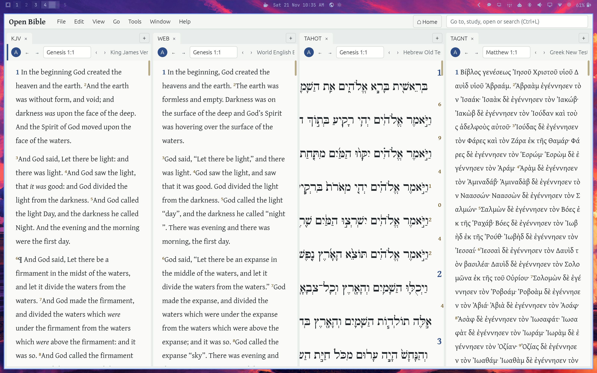
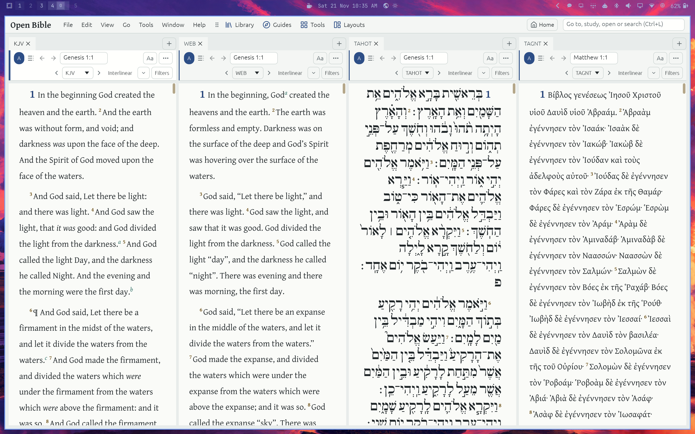
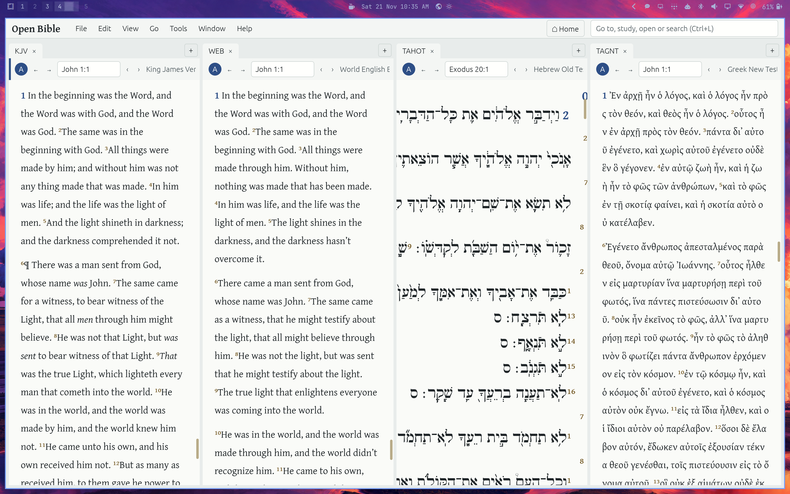
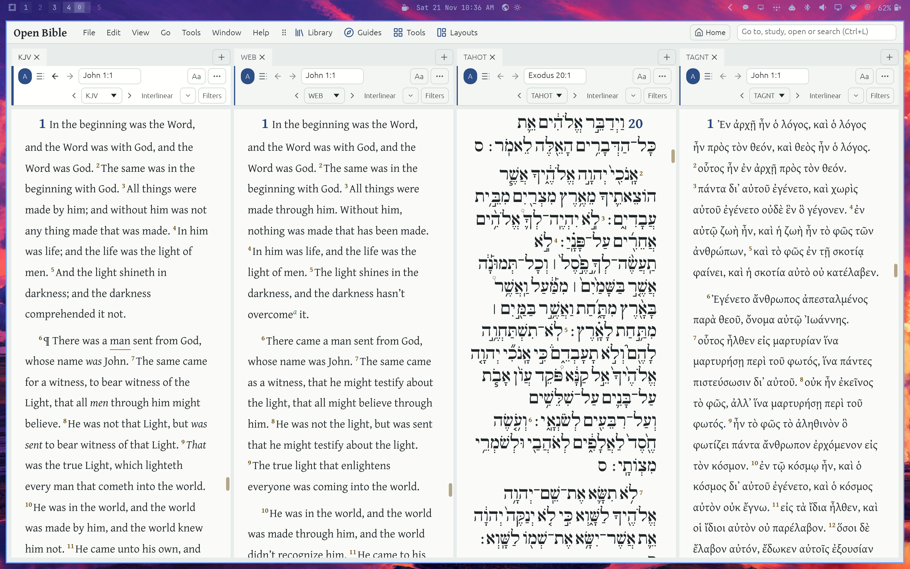

# GPUI vs egui: prototype report

> **PROTOTYPE, throwaway.** This lives only on the branch `prototype-gpui-instead-of-egui`
> and is never merged. It answers one question: *would Open Bible Software look different,
> or run faster, if its UI were built with GPUI (Zed's UI framework, crates.io `gpui` 0.2.2)
> instead of egui 0.37?*
>
> **Outcome:** the owner decided to move the desktop UI to GPUI. The plan is the map
> [#371 Wayfinder: desktop UI on GPUI](https://github.com/inhesrom/openbiblesoftware/issues/371)
> and its tickets #372–#401.

## Verdict

**Speed: GPUI is smoother and cheaper on a real desktop.** On the owner's machine (Intel Arc
B390, Wayland, 120 Hz), with the same scripted four-Panel scenario in both apps:
- GPUI kept the 120 Hz pace while scrolling: 3 % of scroll frames missed it, against 30 % for
  egui.
- GPUI used about a quarter of the CPU per frame across all threads: 2.0 ms against 7.6 ms.

egui's own UI code is fast (about 2.4 ms a frame). The time is lost in eframe's whole frame,
which includes the OpenGL work and reaches about 11 ms at p95, over the 8.3 ms budget. So a
quarter of egui's frames slip to every other refresh (16.8 ms). GPUI's one weak spot was the
prototype's own doing: jumps into long paragraphs hitched for up to 125 ms, because the
prototype shapes text on the UI thread. The egui app lays text out on worker threads (#19),
and a real port would too. Results are [below](#is-it-faster).

**Looks: the same for English and the chrome, worse for Hebrew and Greek.** The look comes
from the app's own fonts (Gentium Plus, Ezra SIL) and design tokens, and both carried over
unchanged; at 2× on the desktop the English text is indistinguishable. GPUI's own text system
cannot wrap a Hebrew paragraph longer than one line, and it breaks Greek and Hebrew words
mid-word. So a GPUI app still needs the app's own text pipeline (ADR 0004), painted through
GPUI, for the same reasons the egui app needed it.

**What GPUI would cost.** None of these blocks the move; each has a ticket on the map.
- **Accessibility needs a newer GPUI than 0.2.2.** The crates.io release has no AccessKit.
  AccessKit support was merged into Zed's main branch in May 2026 (zed-industries/zed#56065)
  and is in `gpui-pre` snapshots and in `gpui-kit`. Which GPUI to depend on is #373.
- **Platforms.** GPUI runs on macOS, Windows and Linux. It has no iOS backend, but mobile
  already uses native shells (ADR 0021). `gpui-kit` claims a wasm32 build; #373 checks it.
- **A networking crate in the UI library.** GPUI 0.2.2 pulls in an HTTP client (`reqwest`,
  `hyper`, `rustls`, `tokio`). `cargo xtask layers` forbids networking crates in any library,
  so the gate or the dependency has to change (#373, #375).
- **A heavier build.** The prototype compiles 569 library crates; the whole egui app compiles
  361. GPUI 0.2.2 did not build here without patching `xattr` for current `libc`.
- **Right-to-left text.** GPUI has no right-to-left or bidi support (zed-industries/zed#31102).
  Typing Hebrew into text inputs stays unsupported, as it is in the egui app (ADR 0004).

**Recommendation:** move to GPUI, keeping our own text pipeline for Resource text and laying
it out on worker threads. Port one surface at a time beside `ui-egui`, which ships until GPUI
reaches parity. A cheaper first check was possible: whether eframe's wgpu renderer closes the
gap. The owner chose not to run it.

## What was built

[`prototype/gpui-shell`](.) is a standalone crate outside the Cargo workspace, with its own
lockfile. It uses path dependencies on `obs-store`, `obs-model`, `obs-scripture`,
`obs-layout` and `obs-fonts`. The app's crates were not changed for it.

- A menu/title bar with the "Open Bible" wordmark, menus, Home and the Command-box field
  (not working).
- Four Panels side by side: KJV with Strong's, WEB, Hebrew TAHOT and Greek TAGNT, read
  read-only from the real library. Each Panel has a tab header, a Link-set chip, back and
  forward (not working), a reference box you can type into, ‹ › chapter arrows, the
  Resource title, a reading pane (GPUI `list`, scrolled pixel by pixel) and a scroll thumb.
- Linking: all four Panels are in Link set A. Scrolling or jumping one moves the others to
  the same Standard verse, through each Bible's Verse map. The leader is the Panel last
  scrolled or clicked.
- Text: paragraphs from `obs_layout::unit_blocks`, with verse and chapter numbers, italics
  for added words, red letters, and small capitals for the divine name (`smcp`). All of it
  goes through GPUI `StyledText` and GPUI's own shaping and wrapping (cosmic-text). Nothing
  from the app's text pipeline is used.

Run it with `cargo run --release --manifest-path prototype/gpui-shell/Cargo.toml`. See the
[README](README.md) for keys, options and the build hacks.

## Does it look different?

The screenshots below are from the scripted bench on the owner's desktop at 2×, at the same
moment in each app: after "Genesis 1:1" (TAGNT shows Matthew 1:1, the first verse it has) and
after "John 1:1" (TAHOT stays at Exodus 20:1, the last Old Testament verse it followed).
Hyprland tiled both windows to the same size, 1600×1000 points.

| | GPUI prototype | egui app |
|---|---|---|
| Genesis 1:1 |  |  |
| John 1:1 |  |  |

**English (Gentium Plus).** At the glyph level the two cannot be told apart
([zoom](screenshots/desktop-zoom-latin-gpui-top-egui-bottom.png): GPUI on top, egui below).
Both use grayscale anti-aliasing with the same font, size and colours. The visible
differences are app features the prototype did not build: egui's large chapter numbers,
first-line indents, and footnote and cross-reference markers. Italics and the small-capital
"Lord" came out right in GPUI with no extra work, because GPUI passes OpenType features per
text run.

**Greek (TAGNT).** Shaping is correct in both: breathings, accents and iota subscripts come
out right ([zoom](screenshots/desktop-zoom-greek-gpui-left-egui-right.png): GPUI left, egui
right). Line breaking is not: GPUI breaks Greek words mid-word ("πρὸ|ς", "ἦ|ν"). GPUI's line
wrapper (`text_system/line_wrapper.rs`, `is_word_char`) treats only ASCII, Latin and Cyrillic
letters as word characters. Every Greek or Hebrew letter counts as a possible break, as it
would in CJK text. egui breaks Greek at spaces.

**Hebrew (TAHOT, Ezra SIL).** Shaping is correct. Vowel points, dagesh and cantillation marks
sit where they should, and words run right to left within a line
([zoom](screenshots/desktop-zoom-hebrew-gpui-left-egui-right.png): GPUI left, egui right).
Any paragraph longer than one line is broken. GPUI works out line breaks over the text in
logical order, then applies them while walking glyphs in visual (left-to-right) order
(`text_system/line.rs`, `paint_line`). The two orders only agree for left-to-right text. In
right-to-left text the lines break in the wrong places, the text runs off the Panel's left
edge and is clipped, and verse numbers drift to the right margin. The paragraph still
reserves the full height, which leaves blank gaps. GPUI has no paragraph direction setting;
the prototype can only right-align. The egui app wraps Hebrew correctly, right-aligned, with
verse numbers in the line.

**Chrome and layout.** GPUI's flexbox (taffy) and Tailwind-style builders made the shell
quick to lay out, and it looks the same as egui's once given the same tokens and the same
interface font (egui's Ubuntu Light was registered with GPUI). Neither framework imposes a
house style.

Screenshots from this machine's Xvfb at 1× show the same things:
[GPUI Genesis](screenshots/gpui-genesis-1.png), [egui Genesis](screenshots/egui-genesis-1.png),
[GPUI John](screenshots/gpui-john-1.png), [egui John](screenshots/egui-john-1.png).

## Is it faster?

### The scenario

Both apps play [scenario.json](scenario.json) frame by frame with the four Bibles linked. The
script:

1. Jumps to Genesis 1:1 (setup; not timed).
2. Takes a screenshot (not timed).
3. Idles for 60 frames.
4. Scrolls the leader 12 points per frame for 600 frames.
5. Flings 3 times (150 points per frame, decaying ×0.94 per frame).
6. Jumps to 8 references across the Bible, 30 frames each.
7. Takes a screenshot at John 1:1 (not timed).
8. Scrolls back up 300 frames.
9. Idles for 30 frames.

The scenario and the report code are one file, [src/bench.rs](src/bench.rs), compiled into
both apps. The egui side runs only when `OBS_PROTO_BENCH` is set
(`crates/ui-egui/src/proto_bench.rs`, plus a few lines in `apps/openbible/src/main.rs`).
That mode opens only the four Bibles, with no User database, Search indexing, Starter sync,
network or update check. It uses the light theme, scrolls with trackpad wheel events applied
in full the frame they arrive, and jumps with `tab.go` with motion reduced, so jumps land at
once in both apps.

Each report records:
- **frame interval**: frame start to the next frame start, which is what you see;
- **frame work**: UI-thread time from frame start to the end of the app's paint pass;
- startup times, process CPU time across all threads, and peak RSS.

A frame counts as *missed* when its interval or work is more than 1.5× the display's frame
budget (12.5 ms at 120 Hz).

Differences between the apps that the bench could not remove:
- **Renderer.** egui draws with OpenGL (glow), GPUI with Vulkan (blade).
- **Startup data loading.** The egui app reads the four Bibles on the UI thread before its
  first frame (`ReadingDoc`). The prototype reads them on four background threads after the
  window is up. The difference is how each app was written, not the framework, so "framework
  ready" is reported on its own row.
- **Layout threading.** The egui app lays text out on worker threads within a 2 ms per-frame
  budget, and linked Panels settle a few frames later. The prototype shapes and wraps on the
  UI thread, the same frame. This is behind GPUI's jump hitches.
- **Drawing work.** egui draws more per Panel (a second toolbar row, note markers, the jump
  flash); the prototype draws its slice.
- **Text flow.** The text wraps differently in each app, so equal scroll distances in points
  show different amounts of text. Line pitch was matched to egui's (36.8 px for English and
  Greek, 39 px for Hebrew).

### On the owner's desktop at 120 Hz

Intel Core Ultra X7 358H with Intel Arc B390 graphics; Hyprland (Wayland) at 120 Hz and 2×;
both windows tiled to 1600×1000 points. Medians over 3 alternating runs of each app. Full
table: [results/desktop-arc-b390-120hz/summary.md](results/desktop-arc-b390-120hz/summary.md);
the raw reports are in [results/desktop-arc-b390-120hz/](results/desktop-arc-b390-120hz/).

| Measure | GPUI | egui |
|---|---:|---:|
| Framework ready, before any app data (ms) | 23 | 30 |
| Four Panels showing text (ms) ¹ | 561 | 2899 |
| Peak RSS (MB) | 775 | 795 |
| **Process CPU per frame, all threads (ms)** | **2.0** | **7.6** |
| **Frames missed, all phases** ² | **2.9 %** | **25.5 %** |
| Steady scroll: frame interval p50 / p95 / p99 / max (ms) | 8.33 / 8.47 / 16.8 / 50 | 8.38 / 16.8 / 24.9 / 34 |
| Steady scroll: frames missed | 3.0 % | 30.0 % |
| Fling: frame interval p50 / p95 / p99 (ms) | 8.33 / 8.47 / 16.8 | 8.35 / 16.8 / 25.0 |
| Jumps: frame interval p50 / p99 / max (ms) | 8.33 / 100 / 125 | 8.36 / 17.0 / 25 |
| UI-thread frame work, all phases: p50 / p95 / p99 (ms) | 1.09 / 4.10 / 12.2 | 2.35 / 4.16 / 6.4 |
| egui only: eframe's frame CPU, all phases: p50 / p95 / p99 (ms) ³ | – | 4.4 / 10.9 / 15.5 |

¹ The egui app reads the four Bibles before its first frame; see above.
² The interval from one frame to the next was over 12.5 ms.
³ eframe's own count: the UI pass, tessellation and the OpenGL calls, but not the buffer swap.
GPUI has no equivalent hook.

What the numbers show:
- **egui's frame cost is in eframe, not in the app's UI code.** The UI pass takes about
  2.4 ms. eframe's whole frame reaches 10.9 ms at p95, over the 8.3 ms budget, and those
  frames show at the next refresh but one (16.8 ms).
- **GPUI held the refresh rate while scrolling and flinging**, at a quarter of the CPU.
- **GPUI's worst frames are the prototype's text shaping.** A trace of the slow frames (on
  Xvfb, the same scenario) found them on jumps that land in long paragraphs: TAHOT's Psalm 119 is one 21.7 KB paragraph,
  and Genesis 50 is 6.5 KB. Laying text out on worker threads, as the egui app does, removes
  that cost from the UI thread.
- **egui varied between sessions; GPUI did not.** In an earlier 120 Hz session on the same
  machine, egui's p95 scroll interval was 12.7 ms instead of 16.8 ms. GPUI's was 8.5 ms both
  times. That session's missed-frame counts are not comparable, because the script scored it
  against 60 Hz. A third session was discarded: its benchmark windows were hidden on another
  workspace, and the compositor stopped sending them frames.

### On this machine's Xvfb (llvmpipe, CPU rendering): not representative

AMD Ryzen 7 7840HS; Xvfb `:97` at 1400×900 with no window manager; Mesa llvmpipe for both
OpenGL and Vulkan. Frame pacing is not comparable here: GPUI paced itself at a fallback
16 ms, while eframe ran unpaced at about 200 fps. With all rendering on the CPU, egui's UI
pass was cheaper than GPUI's (0.94 ms against 1.32 ms at p50) and its process CPU per frame
was lower (36 ms against 45 ms). These results are kept for the record:
[results/xvfb-llvmpipe/summary.md](results/xvfb-llvmpipe/summary.md).

## Build size and compile time

Both were built with default `release` profiles on this machine (16 threads).

| | GPUI prototype (4-Panel slice) | egui app (whole app) |
|---|---:|---:|
| Clean release build, wall / CPU | 114 s / 1420 s | 120 s / 1287 s |
| Library crates compiled | 569 | 361 |
| Release binary | 34 MB | 63 MB |

The binaries are not like for like: the egui binary is the whole app, with every Tool,
importer, search, network and font code. The build cost is the telling part: the GPUI
*slice* alone takes more CPU to build than the whole egui app. Its heavy dependencies:
- `image` with an AV1 encoder (`rav1e`);
- an HTTP stack (`reqwest`, `hyper`, `rustls`, `tokio`);
- D-Bus portals (`zbus`, `ashpd`);
- `cosmic-text`, `font-kit` and `naga`.

Prototype-only hacks needed to build and run here, all in this folder:
- a patched `xattr` 0.2.3 (`libc::ENOATTR` is gone from current `libc` on Linux);
- symlinks to the runtime `.so` files and a dlopen'd fontconfig, because the `-dev` packages
  are not installed;
- a wake-up for GPUI's X11 client under Xvfb with no window manager, which otherwise never
  starts its frame loop (`x11_poke`).

## Known gaps

- **Mouse and keyboard not exercised by the agent.** Xvfb here has no input devices. The
  scripted runs drive the same code paths that keys and the reference box use
  (`ListState::scroll_by` and the jump function), and the owner ran the prototype on the
  desktop, but nobody has tested its clicks, typing and chapter arrows.
- **Not built** (out of scope): back and forward, the Command box, menus that open, Word Info,
  footnote and cross-reference markers, interlinear lines, the jump flash, Text Comparison,
  dark theme, accessibility, Floating windows, and saving or restoring the Workspace.
- **Linking is simplified.** It uses one Link set, follows the leader's top verse, and places
  verses by GPUI's own text positions. Verse ranges and Absent verses fall back to the nearest
  verse before them in the same chapter.
- **Platforms tested:** Linux only (X11 under Xvfb, and Hyprland on Wayland). Not macOS or
  Windows.
- **One desktop GPU.** The speed results come from one Intel integrated GPU. #384 makes the
  windowed bench a supported command so the port can be measured on other machines.

## Where things are

| | |
|---|---|
| Prototype | `prototype/gpui-shell/src/{main,data,bench}.rs` |
| egui bench mode | `crates/ui-egui/src/proto_bench.rs`, `Shell::proto_view_rect`, `apps/openbible/src/main.rs` (`OBS_PROTO_BENCH`) |
| Scenario | `prototype/gpui-shell/scenario.json` |
| One command | `prototype/gpui-shell/bench.sh` → `compare.py` |
| Results | `prototype/gpui-shell/results/desktop-arc-b390-120hz/`, `results/xvfb-llvmpipe/` |
| Screenshots | `prototype/gpui-shell/screenshots/` (`desktop-*` at 2×; the rest from Xvfb at 1×) |
| Migration plan | [#371](https://github.com/inhesrom/openbiblesoftware/issues/371) and #372–#401 |
