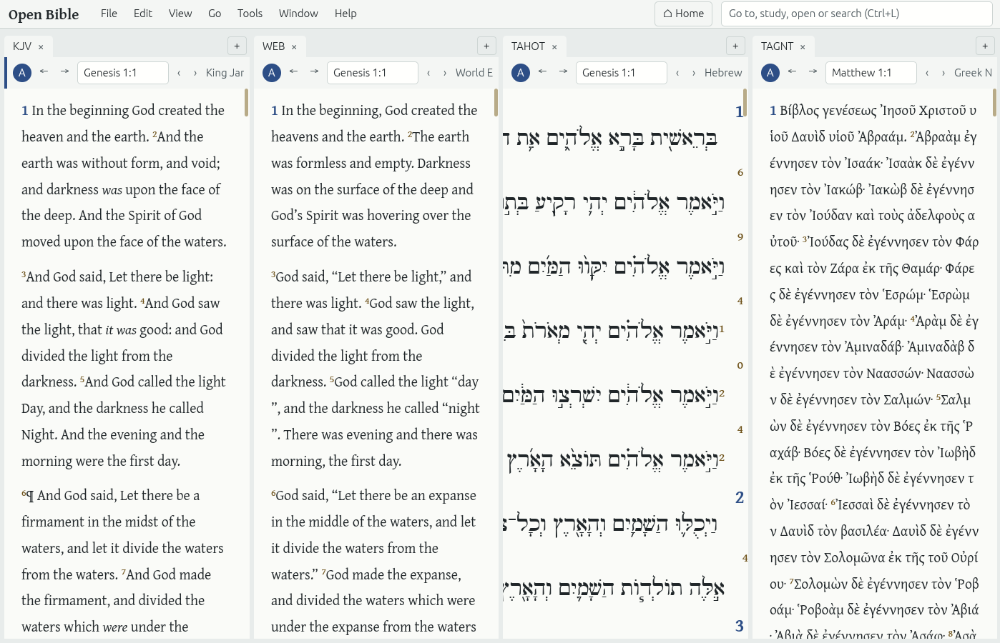
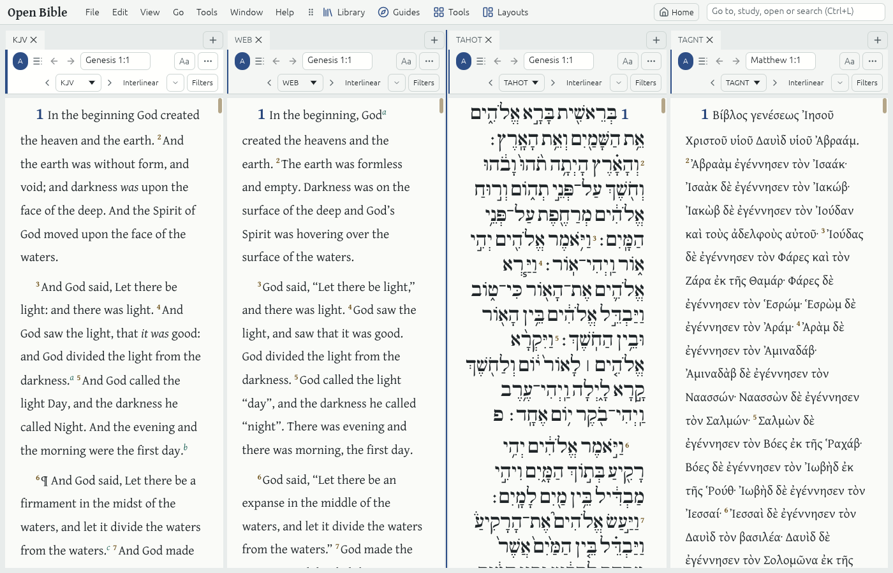
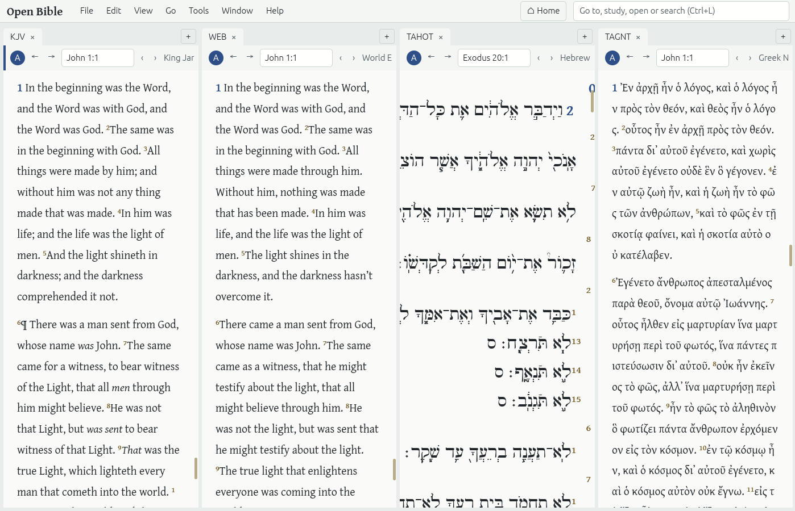
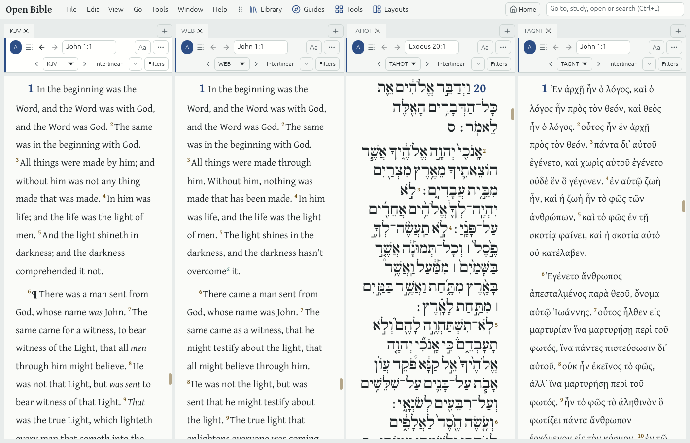

# GPUI vs egui: prototype report

> **PROTOTYPE, throwaway.** This lives only on the branch `prototype-gpui-instead-of-egui`
> and is never merged. It answers one question: *would Open Bible Software look different,
> or run faster, if its UI were built with GPUI (Zed's UI framework, crates.io `gpui` 0.2.2)
> instead of egui 0.37?*

## Verdict

**Looks.** For English text and the window chrome, a user could not tell them apart. The look
comes from the app's own fonts (Gentium Plus, Ezra SIL) and design tokens, and both carry
over unchanged. Where they differ, GPUI is worse for this app. Its own text system cannot
draw a Hebrew paragraph longer than one line, and it breaks Greek and Hebrew words
mid-word. A GPUI version of the app would still need the app's own text pipeline (ADR 0004),
for the same reasons the egui app needed one.

**Speed (provisional; see [the numbers](#is-it-faster)).** On this machine's software
renderer, GPUI was not faster. Its UI-thread work per frame was about 1.4× egui's at the
median and about 5× at the 99th percentile. Jumps hitched for up to ~100 ms because the
prototype shapes long paragraphs on the UI thread. Startup to the first frame was the same
for both frameworks (35 vs 40 ms). **These numbers were measured on Xvfb with llvmpipe (CPU
rendering) and do not represent a real desktop.** The real-GPU run on your desktop
(`bench.sh`) settles this part; its table goes [below](#on-your-desktop-pending).

**What else GPUI 0.2.2 would cost.**
- **No accessibility.** GPUI 0.2.2 has no AccessKit; the egui app's screen-reader support
  (ADR 0004, the a11y audit tests) has nothing to plug into.
- **Fewer platforms.** It runs on macOS, Linux and Windows only. There is no web backend
  (the libraries build for wasm32 today) and no iOS (ADR 0021).
- **A networking crate in the UI library.** GPUI pulls in an HTTP client (`reqwest`,
  `hyper`, `rustls`, `tokio`). `cargo xtask layers` forbids networking crates in any
  library, so a GPUI UI crate would fail that gate.
- **A heavier, less stable build.** Building the prototype compiles 569 library crates (the
  whole egui app compiles 361), including an AV1 encoder pulled in through `image`. GPUI 0.2.2
  did not build here without patching `xattr` for current `libc`.

**Recommendation:** stay on egui. GPUI would be worth another look only if your desktop
run shows a large, user-visible win, and once GPUI gets accessibility and right-to-left
text. Even then, the app's own text pipeline would stay.

## What was built

[`prototype/gpui-shell`](.) is a standalone crate outside the Cargo workspace, with its own
lockfile. It uses path dependencies on `obs-store`, `obs-model`, `obs-scripture`,
`obs-layout` and `obs-fonts`. The app's crates were not changed for it, so no engine changes
were needed.

- A menu/title bar with the "Open Bible" wordmark, menus, Home and the Command-box field
  (not working).
- Four Panels side by side: KJV with Strong's, WEB, Hebrew TAHOT and Greek TAGNT, read
  read-only from the real library. Each Panel has a tab header, a Link-set chip, back and
  forward (not working), a reference box you can type into, ‹ › chapter arrows, the
  Resource title, a reading pane (GPUI `list`, scrolled pixel by pixel) and a scroll thumb.
- Linking: all four Panels are in Link set A. Scrolling or jumping one moves the others to
  the same Standard verse, through each Bible's Verse map. The leader is the Panel last
  scrolled or clicked.
- Text: paragraphs from `obs_layout::unit_blocks`, with verse and chapter numbers, italics
  for added words, red letters, and small capitals for the divine name (`smcp`). All of it
  goes through GPUI `StyledText` and GPUI's own shaping and wrapping (cosmic-text). Nothing
  from the app's text pipeline is used.

Run it with `cargo run --release --manifest-path prototype/gpui-shell/Cargo.toml`. See the
[README](README.md) for keys, options and the build hacks.

## Does it look different?

Screenshots below are from the scripted bench at the same moment in each app: the same
1400×900 window, the same Bibles, after "Genesis 1:1" (TAGNT shows Matthew 1:1) and after
"John 1:1" (TAHOT stays at Exodus 20:1, the last OT verse it followed). They were taken on
Xvfb at 1×.

| | GPUI prototype | egui app |
|---|---|---|
| Genesis 1:1 |  |  |
| John 1:1 |  |  |

**English (Gentium Plus).** At the glyph level the two cannot be told apart by eye
([zoom](screenshots/zoom-latin-gpui-top-egui-bottom.png): GPUI on top, egui below). Both
use grayscale anti-aliasing with the same font, size and colours. GPUI's strokes may be a
hair lighter. The visible differences are app features the prototype did not build: egui's
large chapter numbers, first-line indents, and footnote and cross-reference markers. Italics
and the small-capital "Lord" came out right in GPUI with no extra work, because GPUI passes
OpenType features per text run.

**Greek (TAGNT).** Shaping is correct in both: breathings, accents and iota subscripts
come out right ([zoom](screenshots/zoom-greek-gpui-left-egui-right.png): GPUI left, egui
right). Line breaking is not: GPUI breaks Greek words mid-word ("ἦ|ν", "λόγο|ς"). GPUI's
line wrapper (`text_system/line_wrapper.rs`, `is_word_char`) treats only ASCII, Latin and
Cyrillic letters as word characters. Every Greek or Hebrew letter counts as a possible break,
as it would in CJK text. egui breaks Greek at spaces.

**Hebrew (TAHOT, Ezra SIL).** Shaping is correct. Vowel points, dagesh and cantillation
marks sit where they should, and words run right to left within a line
([zoom](screenshots/zoom-hebrew-gpui-left-egui-right.png): GPUI left, egui right). Any
paragraph longer than one line is broken. GPUI works out line breaks over the text in
logical order, then applies them while walking glyphs in visual (left-to-right) order
(`text_system/line.rs`, `paint_line`). The two orders only agree for left-to-right text. In
right-to-left text the lines break in the wrong places, the text runs off the Panel's left
edge and is clipped, and verse numbers drift to the right margin. The paragraph still
reserves the full height, which leaves blank gaps. GPUI has no paragraph direction setting
at all; the prototype can only right-align. The egui app wraps Hebrew correctly,
right-aligned, with verse numbers in the line.

**Chrome and layout.** GPUI's flexbox (taffy) and Tailwind-style builders made the shell
quick to lay out, and it looks the same as egui's once given the same tokens and the same
interface font (egui's Ubuntu Light was registered with GPUI). Neither framework imposes a
house style.

## Is it faster?

### The scenario

Both apps play [scenario.json](scenario.json) frame by frame in a 1400×900 window with the
four Bibles linked. The script:

1. Jumps to Genesis 1:1 (setup; not timed).
2. Takes a screenshot (not timed).
3. Idles for 60 frames.
4. Scrolls the leader 12 points per frame for 600 frames.
5. Flings 3 times (150 points per frame, decaying ×0.94 per frame).
6. Jumps to 8 references across the Bible, 30 frames each.
7. Takes a screenshot at John 1:1 (not timed).
8. Scrolls back up 300 frames.
9. Idles for 30 frames.

The scenario and the report code are one file, [src/bench.rs](src/bench.rs), compiled into
both apps. The egui side runs only when `OBS_PROTO_BENCH` is set
(`crates/ui-egui/src/proto_bench.rs`, plus a few lines in `apps/openbible/src/main.rs`).
That mode opens only the four Bibles, with no User database, Search indexing, Starter sync,
network or update check. It uses the light theme, scrolls with trackpad wheel events applied
in full the frame they arrive, and jumps with `tab.go` with motion reduced, so jumps land at
once in both apps.

Each report records:
- **frame interval**: frame start to the next frame start, which is what you see;
- **frame work**: UI-thread time from frame start to the end of the app's paint pass;
- startup times, process CPU time across all threads, and peak RSS.

A frame counts as *missed* when it takes more than 1.5× the display's frame budget.

Differences between the apps that the bench could not remove:
- **Frame pacing.** GPUI paces itself to the display refresh it reads from RandR. Xvfb
  reports 0 Hz, so GPUI falls back to 16 ms. eframe paces with the buffer swap, which on Xvfb
  is not vsynced, so it ran at about 200 fps. *On Xvfb, frame intervals and scenario wall time
  are not comparable.* On a real desktop both should be vsync-paced.
- **Startup data loading.** The egui app reads the four Bibles on the UI thread before its
  first frame (`ReadingDoc`, ~1 s each). The prototype reads them on four background threads
  after the window is up. The difference is how each app was written, not the framework, so
  "framework ready" is reported on its own row.
- **Layout threading.** The egui app lays text out on worker threads within a 2 ms per-frame
  budget, and linked Panels settle a few frames later. The prototype shapes and wraps on the
  UI thread, the same frame. A real GPUI port would need the same worker design.
- **Renderer.** egui draws with OpenGL (glow), GPUI with Vulkan (blade).
- **Drawing work.** egui draws more per Panel (a second toolbar row, note markers, the jump
  flash); the prototype draws its slice.
- **Text flow.** The text wraps differently in each app, so equal scroll distances in points
  show different amounts of text. Line pitch was matched to egui's (36.8 px for English and
  Greek, 39 px for Hebrew).

### On this machine's Xvfb (llvmpipe, CPU rendering): not representative

AMD Ryzen 7 7840HS; Xvfb `:97` at 1400×900 with no window manager; Mesa llvmpipe for both
OpenGL and Vulkan; display rate assumed 60 Hz. Medians over 3 alternating runs of each app.
Full table: [results/xvfb-llvmpipe/summary.md](results/xvfb-llvmpipe/summary.md); raw
reports are in [results/xvfb-llvmpipe/](results/xvfb-llvmpipe/).

| Measure | GPUI | egui |
|---|---:|---:|
| Framework ready, before any app data (ms) | 35 | 40 |
| Window's first frame painted (ms) | 65 | 3817 ¹ |
| All four Panels showing text (ms) | 971 | 3843 |
| Peak RSS (MB) | 877 | 844 |
| Process CPU per frame, all threads (ms) ² | 45.2 | 36.2 |
| **UI-thread frame work**, all phases: p50 / p95 / p99 / max (ms) | 1.32 / 3.20 / 8.67 / 99 | 0.94 / 1.37 / 1.71 / 12.4 |
| Steady scroll: p50 / p95 / p99 / max (ms) | 1.32 / 2.98 / 8.18 / 28.1 | 0.92 / 1.14 / 1.26 / 3.2 |
| Fling: p50 / p95 / p99 / max (ms) | 1.40 / 3.97 / 6.15 / 9.2 | 0.94 / 1.13 / 1.23 / 1.3 |
| Jumps: p50 / p95 / p99 / max (ms) | 1.37 / 2.01 / 70.0 / 99 | 1.18 / 1.76 / 3.53 / 12.4 |
| Frames over budget (work > 25 ms), all phases | 0.59 % | 0 % |
| Frame interval, all phases: p50 / p99 / max (ms) ³ | 16.0 / 16.9 / 112 | 4.9 / 6.2 / 16.7 |

¹ Reading the four Bibles happens before the egui app's first frame; see above.
² Includes llvmpipe's rasterizer threads, so it mostly measures software rendering.
³ Not comparable on Xvfb (see pacing above).

What the numbers show, with the Xvfb caveat:
- Both stayed well inside a 60 Hz budget for steady scrolling at the 95th percentile.
- egui's frame work was lower and much flatter. GPUI's tail comes from shaping and wrapping
  whole paragraphs on the UI thread as they scroll into view. A trace of the slow frames
  found GPUI's worst ones (44–110 ms) on jumps that land in long paragraphs. TAHOT's Psalm 119
  is one 21.7 KB paragraph; Genesis 50 is 6.5 KB.
- eframe's own count of its frame's CPU time (UI, tessellation and GL calls, but not the swap)
  was 2.4 ms at the median, 3.3 ms at p99. GPUI has no equivalent hook, so there is no
  matching GPUI figure.

### On your desktop (pending)

The real comparison needs a GPU and a vsynced display. In your desktop session, run:

```sh
RUNS=3 prototype/gpui-shell/bench.sh
```

On Wayland, set `OBS_PROTO_HZ` to your monitor's refresh rate; on X11 it is read from
xrandr. Results go to `prototype/gpui-shell/bench-out/<date>-<host>/` as `summary.md`, the
JSON reports and screenshots (X11, or wlroots Wayland with `grim`). Their table replaces this
section and settles the speed verdict.

| Measure | GPUI | egui |
|---|---:|---:|
| _(from your `summary.md`)_ | | |

## Build size and compile time

Both were built with default `release` profiles on this machine (16 threads).

| | GPUI prototype (4-Panel slice) | egui app (whole app) |
|---|---:|---:|
| Clean release build, wall / CPU | 114 s / 1420 s | 120 s / 1287 s |
| Library crates compiled | 569 | 361 |
| Release binary | 34 MB | 63 MB |

The binaries are not like for like: the egui binary is the whole app, with every Tool,
importer, search, network and font code. The build cost is the telling part: the GPUI
*slice* alone takes more CPU to build than the whole egui app. Its heavy dependencies:
- `image` with an AV1 encoder (`rav1e`);
- an HTTP stack (`reqwest`, `hyper`, `rustls`, `tokio`);
- D-Bus portals (`zbus`, `ashpd`);
- `cosmic-text`, `font-kit` and `naga`.

Prototype-only hacks needed to build and run here, all in this folder:
- a patched `xattr` 0.2.3 (`libc::ENOATTR` is gone from current `libc` on Linux);
- symlinks to the runtime `.so` files and a dlopen'd fontconfig, because the `-dev` packages
  are not installed;
- a wake-up for GPUI's X11 client under Xvfb with no window manager, which otherwise never
  starts its frame loop (`x11_poke`).

## Known gaps

- **Speed on a real GPU and display not measured yet.** The agent's shell has only Xvfb
  with llvmpipe. Pending your `bench.sh` run (above).
- **Mouse and keyboard not exercised by the agent.** Xvfb here has no input devices, and
  GPUI logs "Found no xinput mouse pointers". The scripted run drives the same code paths
  that keys and the reference box use: `ListState::scroll_by` and the jump function.
  Mouse-wheel scrolling, clicking, typing in the reference box and the ‹ › chapter arrows
  have not been tried. Please try them when you run it.
- **Not built** (out of scope): back and forward, the Command box, menus that open, Word
  Info, footnote and cross-reference markers, interlinear lines, the jump flash, Text
  Comparison, dark theme, accessibility, Floating windows, and saving or restoring the
  Workspace.
- **Linking is simplified.** It uses one Link set, follows the leader's top verse, and
  places verses by GPUI's own text positions. Verse ranges and Absent verses fall back to the
  nearest verse before them in the same chapter.
- **Only checked on Linux X11 (Xvfb).** Not macOS or Windows; GPUI's Wayland backend was not
  tried here.

## Where things are

| | |
|---|---|
| Prototype | `prototype/gpui-shell/src/{main,data,bench}.rs` |
| egui bench mode | `crates/ui-egui/src/proto_bench.rs`, `Shell::proto_view_rect`, `apps/openbible/src/main.rs` (`OBS_PROTO_BENCH`) |
| Scenario | `prototype/gpui-shell/scenario.json` |
| One command | `prototype/gpui-shell/bench.sh` → `compare.py` |
| Xvfb results | `prototype/gpui-shell/results/xvfb-llvmpipe/` |
| Screenshots | `prototype/gpui-shell/screenshots/` |
